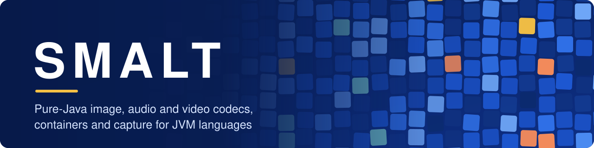
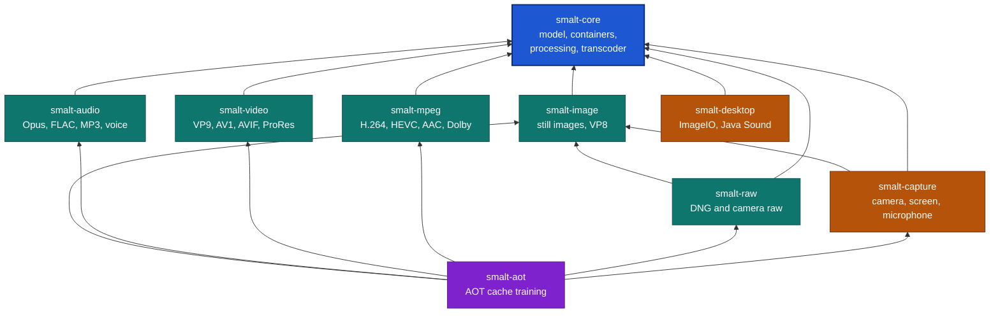
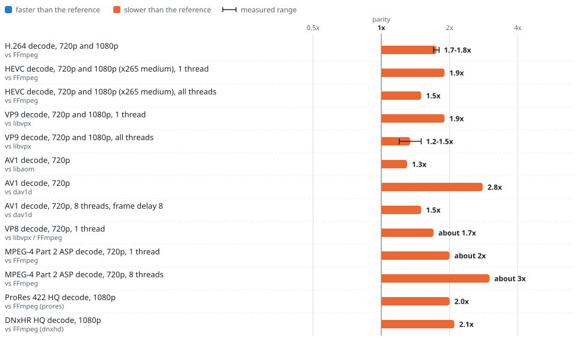
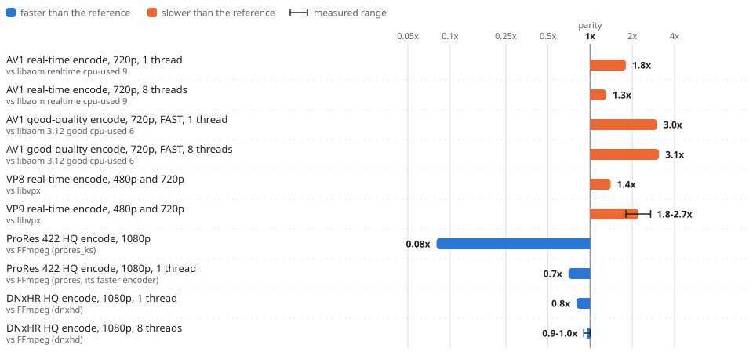
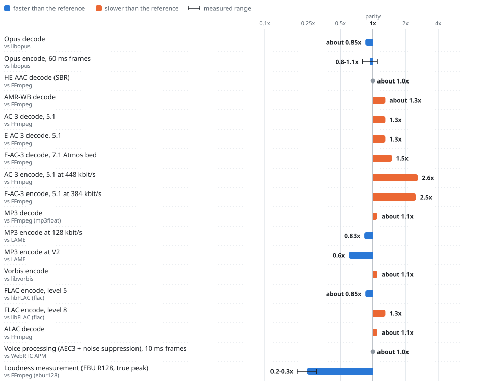
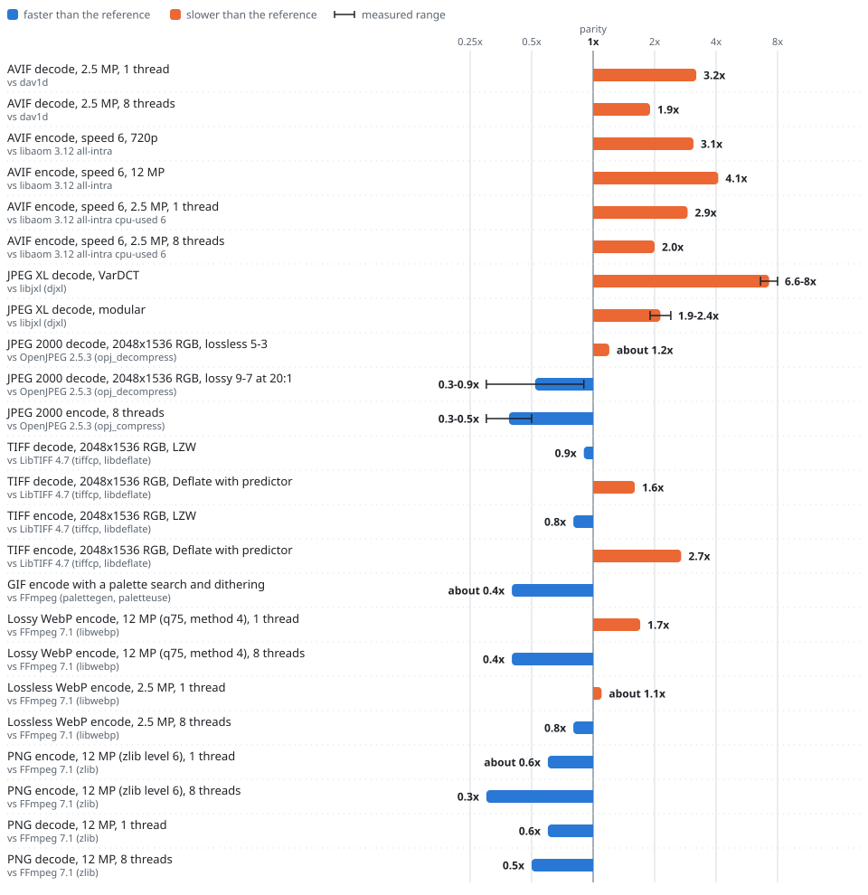
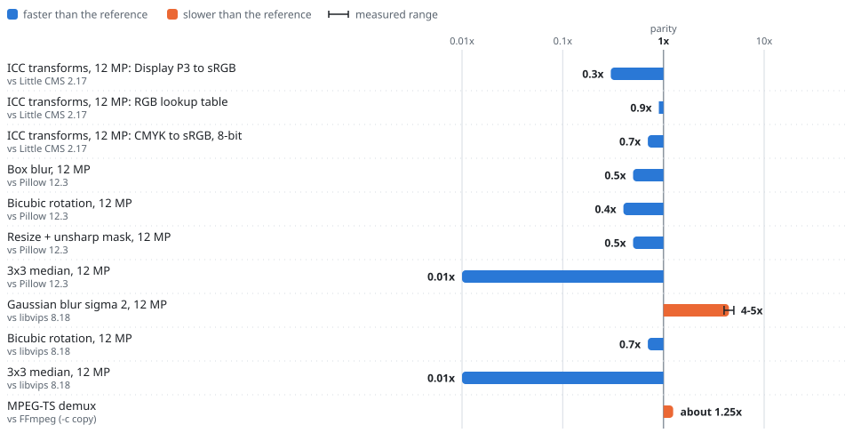

<div align="center">



<br/>

[](https://openjdk.org/projects/jdk/26/)
[](LICENSE)
[](#smalt)
[](https://javadoc.io/doc/com.github.auties00/smalt-core)

</div>

# Smalt

Smalt decodes, encodes, demuxes, muxes and processes **images, audio and video in plain Java**. No FFmpeg, no
JNI, no per-platform binaries to ship, sign or keep patched: the same jar runs everywhere a JDK does. Its codecs
are written from the specifications and ported from permissive reference implementations: H.264, HEVC, VVC,
VP8, VP9, AV1, JPEG, JPEG 2000, JPEG XL, PNG, GIF, WebP, TIFF, Opus, AAC, AC-3, E-AC-3, MP3, Vorbis, FLAC, ALAC
and more.

The decoders reproduce the reference decoders' output *byte for byte* on the official conformance suites (JVT
for H.264, libvpx for VP9, libaom for AV1), and Opus matches libopus packet for packet. Every decoder and
demuxer runs mutation and truncation suites: malformed data raises `MediaException`, never a hang or an
unbounded allocation, within the limits you set with `MediaLimits`.

> [!IMPORTANT]
> Smalt is pre-`1.0`: expect breaking changes between releases until the API is frozen.

**Contents:** [Install](#install) | [Quick start](#quick-start) | [Modules](#modules) |
[Common tasks](#common-tasks) | [Performance](#performance) | [Documentation](#documentation) |
[Contributing](#contributing) | [Acknowledgments](#acknowledgments) | [License](#license)

## Install

Smalt targets **Java 26**. Import the [BOM](bom/README.md), then depend on the artifacts you need.

```xml
<dependencyManagement>
    <dependencies>
        <dependency>
            <groupId>com.github.auties00</groupId>
            <artifactId>smalt-bom</artifactId>
            <version>0.1.0</version>
            <type>pom</type>
            <scope>import</scope>
        </dependency>
    </dependencies>
</dependencyManagement>

<dependencies>
    <dependency>
        <groupId>com.github.auties00</groupId>
        <artifactId>smalt-image</artifactId>
    </dependency>
</dependencies>
```

<details>
<summary><b>Gradle</b></summary>

**Gradle (Kotlin DSL)**

```kotlin
implementation(platform("com.github.auties00:smalt-bom:0.1.0"))
implementation("com.github.auties00:smalt-image")
```

**Gradle (Groovy DSL)**

```groovy
implementation platform('com.github.auties00:smalt-bom:0.1.0')
implementation 'com.github.auties00:smalt-image'
```

</details>

> [!NOTE]
> Smalt is not on Maven Central yet. Until the first release, build it from source with
> `mvn install -DskipTests` and use version `0.1.0-SNAPSHOT`.

### Which artifact do I need

Smalt is modular: take only the artifacts you need. The codecs licensed through patent pools or by Dolby live
in their own artifact, `smalt-mpeg`, so you can leave them out.

- **`smalt-core`:** The media model, the codec registries, every container, image and audio processing, loudness, subtitles, PCM, tag editing and XMP
- **`smalt-image`:** JPEG (and its lossless transforms), JPEG-LS, JPEG 2000, PNG, GIF, WebP, BMP, TIFF, ICO, ANI, JPEG XL, EXIF and image metadata editing, Motion-JPEG, Motion JPEG 2000, PNG, TIFF and GIF video, HAP, and VP8 (lossy WebP is VP8)
- **`smalt-audio`:** Opus, Vorbis, FLAC, ALAC, MP3, Speex, WavPack, ATRAC9, and voice processing
- **`smalt-video`:** VP9, AV1, AVIF, ProRes, DNxHD/DNxHR, DV, Theora, FFV1, QuickTime Animation and CineForm (see the [licensing note](video/README.md#licensing-of-prores-and-dnxhd))
- **`smalt-mpeg`:** H.264, HEVC, VVC, HEIC, MPEG-1 and MPEG-2 video, VC-1, AAC, AMR, MPEG-4 Part 2, H.263, AC-3 and E-AC-3, the codecs licensed through patent pools or by Dolby
- **`smalt-capture`:** Camera, screen and microphone capture, and speaker playback
- **`smalt-raw`:** DNG and camera raw decoding: Canon, Nikon, Sony, Fujifilm, Olympus, Panasonic, Pentax, Minolta and Sigma raw files, demosaicing and camera color rendering; DNG writing and raw to DNG conversion
- **`smalt-desktop`:** ImageIO readers and writers and Java Sound providers for the formats the other artifacts handle
- **`smalt-aot`:** Training workloads for JDK ahead-of-time caches, used only in the training run (see [Start fast with an AOT cache](aot/README.md#start-fast-with-an-aot-cache))

Codecs are discovered at run time: a format whose artifact is missing fails with a
`MediaException.Unsupported` naming the artifact to add.

### JVM flags

- `--add-modules jdk.incubator.vector` turns on the SIMD kernels. It is optional: without it every kernel
  runs its scalar twin, correct but several times slower for video. `MediaRuntime.isVectorized()` tells
  you which one you got.
- `--enable-native-access=com.github.auties00.smalt.capture` (or `ALL-UNNAMED` on the class path) is
  needed only by `smalt-capture`.
- `-XX:AOTCache=app.aot` starts with an ahead-of-time cache recorded from a training run; see
  [Start fast with an AOT cache](aot/README.md#start-fast-with-an-aot-cache).

> [!TIP]
> No flag is required to get started. Add `--add-modules jdk.incubator.vector` when speed matters, and the
> native-access flag only if you use [`smalt-capture`](capture/README.md).

## Quick start

**Make a thumbnail** of a photo (`smalt-image`):

```java
try (var source = MediaSource.of(Path.of("photo.jpg"));
     var output = MediaSink.of(Path.of("thumbnail.webp"))) {
    var image = Images.decode(source, ImageDecoderOptions.ofMinimumSize(512, 512));
    var upright = ImageOps.orient(image.picture(), image.orientation());
    var thumbnail = ImageOps.resize(upright, 512, 512 * upright.height() / upright.width(), ResizeFilter.AREA);
    Images.encode(thumbnail, ImageFormat.WEBP, ImageEncoderOptions.ofQuality(80), output);
}
```

`ImageDecoderOptions.ofMinimumSize` lets the JPEG decoder shrink while decoding, so a 48-megapixel photo never
materializes at full size.

**Transcode a clip** to WebM, trimmed and scaled (`smalt-mpeg` to decode H.264 and AAC, `smalt-video` and
`smalt-audio` to encode VP9 and Opus):

```java
// ffmpeg -ss 10 -to 40 -i clip.mp4 -c:v libvpx-vp9 -c:a libopus -vf scale=-2:480 clip.webm
var options = TranscodeOptions.of(OutputContainer.WEBM).toBuilder()
        .range(10_000_000, 40_000_000)
        .video(VideoTranscodeOptions.builder().maxSize(0, 480).build())
        .listener(progress -> System.out.println(progress.fraction()))
        .build();
var result = Transcoder.transcode(Path.of("clip.mp4"), Path.of("clip.webm"), options);
```

Each stream is copied when the output can carry it and no option changes it, and re-encoded otherwise.

**Read a video** frame by frame:

```java
try (var source = MediaSource.of(Path.of("clip.mp4"));
     var reader = VideoReader.open(source)) {
    VideoFrame frame;
    while ((frame = reader.read()) != null) {
        var picture = frame.picture(); // valid until the next read()
    }
}
```

More in [Common tasks](#common-tasks).

## Modules

Every artifact depends on `smalt-core` only, with three exceptions: `smalt-capture` and `smalt-raw` also use
`smalt-image`, and `smalt-aot` uses every codec artifact, `smalt-capture` and `smalt-raw`.



Blue is the foundation, teal the codec artifacts, amber the artifacts that talk to the platform, purple the
build-time tooling. Each module has its own README with its formats, examples and known limits:

- [**core**](core/README.md): the media model, every container, streaming, subtitles, tags, picture and audio
  processing, color management, the transcoder.
- [**image**](image/README.md): JPEG, PNG, GIF, WebP, TIFF, JPEG 2000, JPEG XL and the other still image
  formats, image metadata, VP8, Motion-JPEG, HAP.
- [**audio**](audio/README.md): Opus, Vorbis, FLAC, ALAC, MP3, the lossless and telephony codecs, voice
  processing.
- [**video**](video/README.md): VP9, AV1, AVIF, ProRes, DNxHD and DNxHR, DV, FFV1, Theora, CineForm.
- [**mpeg**](mpeg/README.md): H.264, HEVC, VVC, HEIC, MPEG-1, MPEG-2 and MPEG-4 video, VC-1, AAC, AC-3,
  E-AC-3, DTS, AMR.
- [**raw**](raw/README.md): DNG and the vendor camera raw formats, developed like a raw converter; DNG writing.
- [**capture**](capture/README.md): cameras, screens, windows, microphones and speakers on Windows, macOS and
  Linux.
- [**desktop**](desktop/README.md): ImageIO and Java Sound providers, so existing desktop code reads Smalt's
  formats.
- [**aot**](aot/README.md): training workloads for JDK ahead-of-time caches, for a fast start.
- [**bom**](bom/README.md): the bill of materials that pins them all.

`smalt-desktop` names no codec either: it serves, through `javax.imageio` and `javax.sound.sampled`, whatever
the codec artifacts next to it handle. The `it` and `tools` directories are build-only.

## Common tasks

One focused example per task, in the README of the module that owns it.

**Files and metadata**

- [Probe a file](core/README.md#probe-a-file)
- [Edit tags](core/README.md#edit-tags)
- [Strip location from a photo](image/README.md#strip-location-from-a-photo) or
  [from a video](core/README.md#strip-location-from-a-video)
- [Read from a buffer, a memory segment, a stream or a URL](core/README.md#read-from-a-buffer-a-memory-segment-a-stream-or-a-url)

**Images**

- [Make an image thumbnail](core/README.md#make-an-image-thumbnail)
- [Decode a region of a large image](core/README.md#decode-a-region-of-a-large-image)
- [Edit a photo](core/README.md#edit-a-photo)
- [Show Display P3, Adobe RGB and CMYK photos correctly](core/README.md#show-display-p3-adobe-rgb-and-cmyk-photos-correctly)
- [Write AVIF](video/README.md#write-avif) and [write HEIC](mpeg/README.md#write-heic)
- [Turn a GIF into an animated WebP](image/README.md#turn-a-gif-into-an-animated-webp)
- [Read the pages of a TIFF and write one](image/README.md#read-the-pages-of-a-tiff-and-write-one)
- [Rotate, crop or recompress a JPEG losslessly](image/README.md#rotate-crop-or-recompress-a-jpeg-losslessly)
- [Decode and encode JPEG 2000](image/README.md#decode-and-encode-jpeg-2000)
- [Develop a camera raw file](raw/README.md#develop-a-camera-raw-file)
- [Use Smalt from ImageIO and Java Sound](desktop/README.md#use-smalt-from-imageio-and-java-sound)

**Audio**

- [Read audio as PCM](core/README.md#read-audio-as-pcm)
- [Write audio to a file](core/README.md#write-audio-to-a-file)
- [Encode FLAC](audio/README.md#encode-flac)
- [Measure loudness and normalize](core/README.md#measure-loudness-and-normalize)
- [Convert speech to AMR](mpeg/README.md#convert-speech-to-amr)

**Video**

- [Take a video thumbnail](core/README.md#take-a-video-thumbnail)
- [Decode video frames](core/README.md#decode-video-frames)
- [Write video to a file](core/README.md#write-video-to-a-file)
- [Encode ProRes for editing](video/README.md#encode-prores-for-editing)

**Containers, streaming and transcoding**

- [Transcode](core/README.md#transcode)
- [Join, combine, speed up and fade](core/README.md#join-combine-speed-up-and-fade)
- [Remux to MP4 without re-encoding](core/README.md#remux-to-mp4-without-re-encoding) or
  [to WebM](core/README.md#remux-to-webm)
- [Read a .ts](core/README.md#read-a-ts)
- [Walk the packets of any container](core/README.md#walk-the-packets-of-any-container)
- [Package HLS](core/README.md#package-hls)
- [Convert subtitles](core/README.md#convert-subtitles)

**Real time and capture**

- [Code Opus in real time](audio/README.md#code-opus-in-real-time)
- [Code any audio codec in real time](core/README.md#code-any-audio-codec-in-real-time)
- [Code video in real time](mpeg/README.md#code-video-in-real-time)
- [Capture the camera](capture/README.md#capture-the-camera)
- [Capture a window or a part of a screen](capture/README.md#capture-a-window-or-a-part-of-a-screen)
- [Capture the microphone and play to the speaker](capture/README.md#capture-the-microphone-and-play-to-the-speaker)
- [Start fast with an AOT cache](aot/README.md#start-fast-with-an-aot-cache)

## Performance

Hot kernels use the [Vector API](https://docs.oracle.com/en/java/javase/26/docs/api/jdk.incubator.vector/module-summary.html),
with scalar twins wherever SIMD is unavailable, and work is spread over one bounded thread pool.

Single thread, SIMD on, measured against the native libraries on one desktop (i7-9700K, AVX2). The figure is
Smalt's time relative to native: lower is better, 1.0 is parity.

> [!NOTE]
> A bar shows Smalt's time divided by the reference's time. It starts at **1.0x (parity)** and runs *left* when
> Smalt is faster, *right* when it is slower. A whisker marks a measured range. The numbers live in
> [`tools/readme/performance.tsv`](tools/readme/performance.tsv); `python tools/readme/charts.py` redraws the
> charts and the text lists from them.

<!-- perf:begin -->
<!-- Generated by tools/readme/charts.py from tools/readme/performance.tsv; do not edit by hand. -->

### Video decoding

One thread unless the row says otherwise.

<picture>
  <source media="(prefers-color-scheme: dark)" srcset=".github/assets/perf-video-decode-dark.svg">
  
</picture>

<details>
<summary>Video decoding: the numbers as text</summary>

- H.264 decode, 720p and 1080p, against FFmpeg: **1.7-1.8x**
- HEVC decode, 720p and 1080p (x265 medium), 1 thread, against FFmpeg: **1.9x**
- HEVC decode, 720p and 1080p (x265 medium), all threads, against FFmpeg: **1.5x**
- VP9 decode, 720p and 1080p, 1 thread, against libvpx: **1.9x**
- VP9 decode, 720p and 1080p, all threads, against libvpx: **1.2-1.5x**
- AV1 decode, 720p, against libaom: **1.3x**
- AV1 decode, 720p, against dav1d: **2.8x**
- AV1 decode, 720p, 8 threads, frame delay 8, against dav1d: **1.5x**
- VP8 decode, 720p, 1 thread, against libvpx / FFmpeg: **about 1.7x**
- MPEG-4 Part 2 ASP decode, 720p, 1 thread, against FFmpeg: **about 2x**
- MPEG-4 Part 2 ASP decode, 720p, 8 threads, against FFmpeg: **about 3x**
- ProRes 422 HQ decode, 1080p, against FFmpeg (prores): **2.0x**
- DNxHR HQ decode, 1080p, against FFmpeg (dnxhd): **2.1x**

</details>

### Video encoding

BD-rate against the reference encoder is in the text list.

<picture>
  <source media="(prefers-color-scheme: dark)" srcset=".github/assets/perf-video-encode-dark.svg">
  
</picture>

<details>
<summary>Video encoding: the numbers as text</summary>

- AV1 real-time encode, 720p, 1 thread, against libaom realtime cpu-used 9: **1.8x** (BD-rate 3.7% PSNR-Y higher)
- AV1 real-time encode, 720p, 8 threads, against libaom realtime cpu-used 9: **1.3x** (BD-rate 3.7% PSNR-Y higher)
- AV1 good-quality encode, 720p, FAST, 1 thread, against libaom 3.12 good cpu-used 6: **3.0x** (BD-rate 15% PSNR-Y, 19% SSIM-Y higher)
- AV1 good-quality encode, 720p, FAST, 8 threads, against libaom 3.12 good cpu-used 6: **3.1x** (BD-rate 15% PSNR-Y, 19% SSIM-Y higher)
- VP8 real-time encode, 480p and 720p, against libvpx: **1.4x** (BD-rate 2.6% PSNR-Y, 2.9% SSIM-Y lower)
- VP9 real-time encode, 480p and 720p, against libvpx: **1.8-2.7x** (BD-rate 14% PSNR-Y, 16.5% SSIM-Y lower)
- ProRes 422 HQ encode, 1080p, against FFmpeg (prores_ks): **0.08x**
- ProRes 422 HQ encode, 1080p, 1 thread, against FFmpeg (prores, its faster encoder): **0.7x**
- DNxHR HQ encode, 1080p, 1 thread, against FFmpeg (dnxhd): **0.8x**
- DNxHR HQ encode, 1080p, 8 threads, against FFmpeg (dnxhd): **0.9-1.0x**

</details>

### Audio

Codecs, voice processing and loudness measurement.

<picture>
  <source media="(prefers-color-scheme: dark)" srcset=".github/assets/perf-audio-dark.svg">
  
</picture>

<details>
<summary>Audio: the numbers as text</summary>

- Opus decode, against libopus: **about 0.85x**
- Opus encode, 60 ms frames, against libopus: **0.8-1.1x**
- HE-AAC decode (SBR), against FFmpeg: **about 1.0x**
- AMR-WB decode, against FFmpeg: **about 1.3x**
- AC-3 decode, 5.1, against FFmpeg: **1.3x**
- E-AC-3 decode, 5.1, against FFmpeg: **1.3x**
- E-AC-3 decode, 7.1 Atmos bed, against FFmpeg: **1.5x**
- AC-3 encode, 5.1 at 448 kbit/s, against FFmpeg: **2.6x** (with channel coupling)
- E-AC-3 encode, 5.1 at 384 kbit/s, against FFmpeg: **2.5x** (with channel coupling)
- MP3 decode, against FFmpeg (mp3float): **about 1.1x**
- MP3 encode at 128 kbit/s, against LAME: **0.83x**
- MP3 encode at V2, against LAME: **0.6x**
- Vorbis encode, against libvorbis: **about 1.1x**
- FLAC encode, level 5, against libFLAC (flac): **about 0.85x**
- FLAC encode, level 8, against libFLAC (flac): **1.3x**
- ALAC decode, against FFmpeg: **about 1.1x**
- Voice processing (AEC3 + noise suppression), 10 ms frames, against WebRTC APM: **about 1.0x**
- Loudness measurement (EBU R128, true peak), against FFmpeg (ebur128): **0.2-0.3x**

</details>

### Still images

Decoding and encoding of whole images.

<picture>
  <source media="(prefers-color-scheme: dark)" srcset=".github/assets/perf-images-dark.svg">
  
</picture>

<details>
<summary>Still images: the numbers as text</summary>

- AVIF decode, 2.5 MP, 1 thread, against dav1d: **3.2x**
- AVIF decode, 2.5 MP, 8 threads, against dav1d: **1.9x**
- AVIF encode, speed 6, 720p, against libaom 3.12 all-intra: **3.1x** (BD-rate 0-7% lower)
- AVIF encode, speed 6, 12 MP, against libaom 3.12 all-intra: **4.1x** (BD-rate 0-7% lower)
- AVIF encode, speed 6, 2.5 MP, 1 thread, against libaom 3.12 all-intra cpu-used 6: **2.9x** (BD-rate 2% PSNR-Y, 5% SSIM-Y lower)
- AVIF encode, speed 6, 2.5 MP, 8 threads, against libaom 3.12 all-intra cpu-used 6: **2.0x** (BD-rate 2% PSNR-Y, 5% SSIM-Y lower)
- JPEG XL decode, VarDCT, against libjxl (djxl): **6.6-8x**
- JPEG XL decode, modular, against libjxl (djxl): **1.9-2.4x**
- JPEG 2000 decode, 2048x1536 RGB, lossless 5-3, against OpenJPEG 2.5.3 (opj_decompress): **about 1.2x** (loaded machine, wide error bars)
- JPEG 2000 decode, 2048x1536 RGB, lossy 9-7 at 20:1, against OpenJPEG 2.5.3 (opj_decompress): **0.3-0.9x** (loaded machine, wide error bars)
- JPEG 2000 encode, 8 threads, against OpenJPEG 2.5.3 (opj_compress): **0.3-0.5x**
- TIFF decode, 2048x1536 RGB, LZW, against LibTIFF 4.7 (tiffcp, libdeflate): **0.9x**
- TIFF decode, 2048x1536 RGB, Deflate with predictor, against LibTIFF 4.7 (tiffcp, libdeflate): **1.6x**
- TIFF encode, 2048x1536 RGB, LZW, against LibTIFF 4.7 (tiffcp, libdeflate): **0.8x**
- TIFF encode, 2048x1536 RGB, Deflate with predictor, against LibTIFF 4.7 (tiffcp, libdeflate): **2.7x**
- GIF encode with a palette search and dithering, against FFmpeg (palettegen, paletteuse): **about 0.4x** (8% smaller, 1.6 dB better)
- Lossy WebP encode, 12 MP (q75, method 4), 1 thread, against FFmpeg 7.1 (libwebp): **1.7x** (byte-identical to libwebp)
- Lossy WebP encode, 12 MP (q75, method 4), 8 threads, against FFmpeg 7.1 (libwebp): **0.4x** (byte-identical to libwebp; see the eight-thread caveat)
- Lossless WebP encode, 2.5 MP, 1 thread, against FFmpeg 7.1 (libwebp): **about 1.1x**
- Lossless WebP encode, 2.5 MP, 8 threads, against FFmpeg 7.1 (libwebp): **0.8x** (see the eight-thread caveat)
- PNG encode, 12 MP (zlib level 6), 1 thread, against FFmpeg 7.1 (zlib): **about 0.6x** (Smalt's own deflate compressor, 0.4x of the JDK zlib's time at level 6)
- PNG encode, 12 MP (zlib level 6), 8 threads, against FFmpeg 7.1 (zlib): **0.3x** (the PNG split into independently deflated bands of about 1 MiB; see the eight-thread caveat)
- PNG decode, 12 MP, 1 thread, against FFmpeg 7.1 (zlib): **0.6x**
- PNG decode, 12 MP, 8 threads, against FFmpeg 7.1 (zlib): **0.5x** (see the eight-thread caveat)

</details>

### Processing and demuxing

Color transforms, picture operations and container reading.

<picture>
  <source media="(prefers-color-scheme: dark)" srcset=".github/assets/perf-processing-dark.svg">
  
</picture>

<details>
<summary>Processing and demuxing: the numbers as text</summary>

- ICC transforms, 12 MP: Display P3 to sRGB, against Little CMS 2.17: **0.3x**
- ICC transforms, 12 MP: RGB lookup table, against Little CMS 2.17: **0.9x**
- ICC transforms, 12 MP: CMYK to sRGB, 8-bit, against Little CMS 2.17: **0.7x**
- Box blur, 12 MP, against Pillow 12.3: **0.5x**
- Bicubic rotation, 12 MP, against Pillow 12.3: **0.4x**
- Resize + unsharp mask, 12 MP, against Pillow 12.3: **0.5x**
- 3x3 median, 12 MP, against Pillow 12.3: **0.01x**
- Gaussian blur sigma 2, 12 MP, against libvips 8.18: **4-5x**
- Bicubic rotation, 12 MP, against libvips 8.18: **0.7x**
- 3x3 median, 12 MP, against libvips 8.18: **0.01x**
- MPEG-TS demux, against FFmpeg (-c copy): **about 1.25x**

</details>

<!-- perf:end -->

Multi-threaded decoding narrows the gap where the stream allows it (tiles, slices, frame parallelism).

<details>
<summary><b>Still images against FFmpeg 7.1, and the eight-thread caveat</b></summary>

Still images, 12 MP photo, against FFmpeg 7.1 (libwebp, zlib) on the same machine, ratio of times: lossy WebP encode
(q75, method 4, byte-identical to libwebp) 1.7x on one thread and 0.4x on eight; PNG encode (zlib level 6) about 0.6x on one
thread (Smalt's own deflate compressor, 0.4x of the JDK zlib's time at level 6) and 0.3x on eight, the PNG split into independently deflated bands of about 1 MiB; PNG decode 0.6x on one thread
and 0.5x on eight; lossless WebP encode (2.5 MP) about 1.1x on one thread and 0.8x on eight. Eight-thread figures come from
same-JVM interleaved comparisons combined with the quiet-machine FFmpeg times, and carry the noise of a shared
machine.

</details>

<details>
<summary><b>How these numbers are measured, and what CI measures</b></summary>

Absolute numbers, effects of a few percent and the comparison with FFmpeg and the other native libraries need
dedicated hardware: one quiet machine with a fixed clock, both sides run in the same session with the same
thread counts, ratios reported rather than times. The hosted CI runners are shared virtual machines whose speed
drifts from run to run and with the CPU model a job lands on, so CI measures only what holds within one job
([tools/bench](tools/bench)): a weekly A/B of the hot paths, base and head built side by side and timed fork by
fork, that fails when a case gets 20% slower, and, on every pull request, the bytes allocated per operation
against the base, which do not depend on the machine's load. The figures in this section come from the desktop
above, not from CI.

</details>

<details>
<summary><b>Where threads do not help, and what costs memory</b></summary>

- Lossless WebP decoding is one sequential entropy stream, and VP9 decoding on several threads is bounded by
  the serial parse of the slowest tile column (frames do not overlap).
- Under saturation the shared pool splits the processors fairly between operations, so short operations see
  a higher tail latency.
- Speculative parallel JPEG decoding uses up to about 7.7 MB more per 12-megapixel image, parallel animated
  GIF decoding up to about 50 MB per 720p animation, and JPEG XL decoding about 130 bytes per pixel.
- On hardware whose vectors are 128 bits wide (ARM NEON and 128-bit SVE, such as Apple silicon and Graviton;
  x86 without AVX2), the kernels written for 256-bit vectors run their scalar twins, since the JIT compiler
  cannot compile their operations there: the H.264 decoder's motion compensation, weighted prediction, 8x8
  transform and deblocking, the H.264 encoder's pixel metrics, transforms and interpolation, the HEVC,
  MPEG-4 Part 2 and H.263, VP9, AV1 (decoder and encoder) and VP8 encoder kernels, the VP8 decoder's
  transform, interpolation and normal loop filter, the JPEG DCTs and color conversion, the JPEG 2000
  wavelets, the ProRes and DNxHD block transforms, palette search and SILK's fixed-point filters. The kernels
  that gather (Vorbis's post-rotation) do the same on ARM NEON, which has no gather instructions. The other
  vector kernels use 128-bit vectors there, the tap sums of rotations and affine warps included (their taps
  are gathered by scalar code).
- Until the JIT compiler has compiled them, Vector API kernels allocate on every call; three-layer
  error-resilient VP9 at speed 5, for example, allocates 0.2 to 0.8 MB per frame until its transform kernel
  is compiled. An AOT cache that stores compiled vector code removes that phase (see
  [Start fast with an AOT cache](aot/README.md#start-fast-with-an-aot-cache)).

</details>

## Documentation

Every public and protected member of the exported packages carries a Javadoc comment stating its contract, so
this README only covers the essentials. For anything not spelled out here, refer to the [Javadoc](https://javadoc.io/doc/com.github.auties00/smalt-core). If a
format or feature you need is missing, open an [issue](https://github.com/Auties00/Smalt/issues) or start a [discussion](https://github.com/Auties00/Smalt/discussions).

## Contributing

Smalt welcomes contributions from anyone: new formats, faster kernels, bug reports with sample files, and
measurements on hardware we don't have. Performance and correctness are absolute priorities: a change to a
decoder must keep its output bit-exact, and a performance claim needs an A/B measurement against the code it
replaces.

The ground rules, in short:

- **Bit-exact stays bit-exact.** Conformance and differential tests hold every decoder to its reference.
- **Measure performance claims.** An A/B against the code the change replaces, not an impression.
- **Port only from permissive code.** See [Licensing of contributions](#licensing-of-contributions).
- **Write to people yourself.** See [AI contributions](#ai-contributions).

How the project is tested and built, topic by topic:

<details>
<summary><b>Test data</b></summary>

Conformance tests read official test vectors and Xiph clips, listed with their checksums in
[tools/testdata](tools/testdata). `python tools/testdata/testdata.py fetch --tier smoke` downloads the few
hundred megabytes CI runs on every pull request, `--tier full` everything (about 17 GB of vectors and 6 GB of archive members). Tests also download
a missing vector on first use (`-Dsmalt.conformance.download=false` turns that off), retrying a host that
answers 429 or 5xx or does not answer, and skip, rather than fail, when its data cannot be had. The full tier holds the public conformance suites: the Argon AV1 coverage
streams, ISO/IEC 14496-4 MPEG-4 Visual (with the ISO/IEC 14496-5 reference decoder as the oracle), the surviving
ISO/IEC 13818-4 MPEG-2 video streams (with the ISO/IEC 13818-5 reference decoder as the oracle), ISO/IEC
14496-26 AAC, ISO/IEC 15444-4 JPEG 2000, the libjxl conformance set, MPEG's ISO base media file format
conformance files and the DASH-IF test vectors. Members of archives too large to download whole are fetched by
HTTP range ([tools/testdata/archives.tsv](tools/testdata)), and every source carries a licence note; none of it is
committed. The nightly workflow runs the full tier on Linux x64 (and the `it` module's part of it on Windows and
macOS), and, weekly, every module on Windows, macOS and Linux arm64.

</details>

<details>
<summary><b>Oracle tools and skips</b></summary>

Differential tests compare Smalt with reference tools run as black boxes: ffmpeg and ffprobe, the libwebp,
libjxl, OpenJPEG, OpenJPH, libjpeg-turbo, libtiff, FLAC and opus-tools command lines, ExifTool, MP4Box, MKVToolNix,
mkvalidator, TSDuck, SoX, and small libpng, Little CMS and libopus programs. [tools/testdata/oracles.tsv](tools/testdata/oracles.tsv)
pins them per CI platform, and `python tools/testdata/oracles.py install` installs that set (`versions` prints
what is installed). A test whose tool is missing skips; CI sets `SMALT_TEST_REQUIRE_ORACLES`
(`-Dsmalt.test.requireOracles=true` locally) so that it fails instead. Every skip carries a stable reason id,
`[family:name] detail`, through the test kit's `Skip` class, and `python tools/testdata/skips.py check --job
<job>` compares the skips of a build, per CI job, module, test class and reason, with
`tools/testdata/skip-baseline.tsv`: CI fails when a count grows, and the counts of the oracle, device and
environment families may only shrink.

</details>

<details>
<summary><b>Tolerances and validators</b></summary>

A differential or conformance test declares how far Smalt may differ from the reference, once per codec, with the
test kit's `Tolerance`, in the comparison modes of FFmpeg's FATE and the criteria the standards define: exact for the
normative decoders (H.264, HEVC, VP8, VP9, AV1, FLAC, lossless WebP and JPEG XL, JPEG luma against libjpeg-turbo's
`djpeg -dct int`), off by one, maximum and mean absolute difference, RMS, PSNR, SNR and the fraction of differing
samples for the float decoders and the inverse DCTs the standards leave free, the ISO/IEC 11172-4 full accuracy
limits for MPEG audio (the compliance streams and every ffmpeg comparison), and libopus' `opus_compare` criterion
for Opus (ported, and checked against the tool where it is installed); a violation names the rule, every
statistic and the first differing sample and frame. `Ieee1180` runs the IEEE 1180-1990 accuracy test that
ISO/IEC 14496-2 and ITU-T H.263 require of the MPEG-4 Part 2 and H.263 inverse DCT.

Files Smalt writes are checked by validators that share no code with its demuxers, written from the
specifications in the test kit's `testkit.validate` package: ISO base media files, fragmented MP4 and CMAF
(ISO/IEC 14496-12, 14496-14 and 14496-15, 23000-19: box layout, sample tables, durations, codec configurations,
fragment sequence, data offsets and timelines, `sidx` and `mfra`), Matroska and WebM (RFC 8794 and RFC 9559),
MPEG-2 transport streams (ISO/IEC 13818-1: packets, continuity, PSI with CRCs, PES headers, PCR intervals), MPEG
program streams and MPEG-1 system streams (pack headers, system clock pacing at the mux rate, system headers, the
program stream map's CRC, PES headers and timestamps, DVD navigation packets), MXF (SMPTE ST 377-1: KLV
coding, partition packs and their offsets and byte counts, the KLV alignment grid, the primer pack, strong
references and package links of the header metadata, index table entries against the essence elements, the
random index pack), HLS
(RFC 8216, with the checks of Apple's `mediastreamvalidator`: versions, durations, `BANDWIDTH`, `CODECS`,
`RESOLUTION`, rendition groups, every segment) and MPEG-DASH (the MPD schema of ISO/IEC 23009-1, segment
addressing, timelines against `tfdt`, `codecs`, and `bandwidth` with `minBufferTime`). Where they are installed,
GPAC's `MP4Box -info`, the Matroska foundation's `mkvalidator` and TSDuck's `analyze` plugin read the same files;
`mkvalidator` 0.6 predates AV1, the block addition mapping of WebM and several registered codec IDs, so the reports
those draw are accepted, each with its reason in `testkit.validate.Validators`.
Every output of the container tests' muxing helpers, every container and codec pair of the `it` module's
mux/demux property, every HLS and DASH presentation of the packager tests and every file a test hands to
`Oracle.assertDecodesCleanly` goes through them. The output of every encoder is also decoded by a reference
decoder (ffmpeg with libvpx, dav1d, libopus and opencore-amr, the `flac` tool, libpng, libjpeg-turbo, libwebp,
OpenJPEG, libjxl and libtiff for images and metadata edits) and compared with Smalt's own decode under the
codec's declared tolerance (`it`'s `ReferenceDecodeTest` and `ReferenceImageDecodeTest`).

</details>

<details>
<summary><b>I/O behavior and golden dumps</b></summary>

Every demuxer, reader and image decoder runs through the test kit's I/O behavior harnesses
(`testkit.container.DemuxerAsserts`, `testkit.container.ReaderAsserts`, `testkit.image.ImageDecoderAsserts`):
the same input is read in one-byte and random-sized chunks, with its length hidden, from a stream read once,
twice over one source, and with an I/O failure injected at a bounded, evenly spread set of reads (of whole reads,
of reads cut to random sizes, and of a stream read once), and every run must give the same packets, frames and
pictures or fail with a clean `MediaException.Io`; seeks are checked against the `Demuxer.seek` contract. Each input also has a readable golden dump (per-packet timestamps, flags, sizes and CRC-32, per-frame
CRC) under the module's `src/test/resources/dumps`; `-Dsmalt.test.updateDumps=true` rewrites the dumps, whose
diff is then reviewed. The inputs are small samples made by the scripts in
[tools/testdata/behavior](tools/testdata/behavior) and pinned by SHA-256, and smoke-tier vectors. A change
that adds a container or a codec adds its inputs to these tests, as the `testkit.io` package documentation
describes.

</details>

<details>
<summary><b>Fuzzing</b></summary>

Every decoder, demuxer, parser and metadata reader has a coverage-guided fuzz target, a
[Jazzer](https://github.com/CodeIntelligenceTesting/jazzer) `@FuzzTest` method in the `fuzz` test package of its
module: anything but a `MediaException` escaping from the entry point is a finding, and so is a `MediaException`
that only reports an internal failure, such as an index out of bounds, that the entry point caught. Every build replays the
targets' seeds and the inputs of past findings (`src/test/resources/fuzz-regressions`) as plain tests;
[ClusterFuzzLite](https://google.github.io/clusterfuzzlite/) fuzzes every pull request for a short while and
every night for hours. `python tools/fuzz/fuzz.py run core:DemuxerFuzzTest.mp4` fuzzes one target locally;
[tools/fuzz](tools/fuzz) describes how to reproduce, minimize and save a finding.

</details>

<details>
<summary><b>Hostile inputs and properties</b></summary>

The `hostile` tests of the `it` module feed every entry point inputs built to exhaust it: decompression bombs
(headers rewritten to declare pictures, channel counts, frame counts and sizes over the `MediaLimits`, which must
be rejected with `MediaException.LimitExceeded` before the declared memory is allocated, as a per-call allocation
meter checks), cyclic offsets (TIFF and EXIF directories chained to themselves, HEIF images derived from
themselves, a Matroska seek head pointing at itself) and nesting tens of thousands of levels deep, parsed on a
quarter of the JVM's default thread stack. Tests run at the default thread stack size, and CI replays every fuzz
seed and finding, and runs these tests, in a 256 MiB heap; a nightly job fuzzes a quarter of the targets in turn
with that heap.

The `property` tests check invariants that need no reference output: lossless coding (PNG, TIFF, JPEG 2000,
lossless JPEG, AVIF, WebP, GIF, ICO, ANI, JPEG XL, FLAC, ALAC, PCM, and JPEG XL and other encoders' lossless JPEG
encoded by the reference tools) decodes to
every input sample; muxing then demuxing returns every packet of every codec in every container Smalt writes;
tag edits read back as written, are idempotent and never touch the media; video seeks return what a linear
decode returns from the target on; and output does not depend on the thread count, the load on the shared
threads or `smalt.threads`.

</details>

<details>
<summary><b>Coverage, soak and concurrency</b></summary>

`mvn -Pcoverage verify` measures line and branch coverage with JaCoCo and `tools/coverage/coverage.py` turns the
report into a map of the code no test reaches, per codec and container; the nightly workflow publishes it and
fails when an area falls below [tools/coverage/baseline.tsv](tools/coverage). The smoke tier holds a vector for
each decoder feature the map would otherwise show as untested (codeword reordering and low delay SBR in AAC, FMO
slice group maps in H.264, ThunderScan and old-style JPEG in TIFF, RW2 tiles, Canon sRAW and mRAW, the 3GPP AMR
sequences); where no small vector exists the tests keep their own, coded by a reference encoder and checked
against its decoder (AV1 super-resolution and frame resizing from libaom, HEVC picture hashes on multi-row
pictures from the HM reference encoder), or compare with a reference decoder
built from its source (AMR comfort noise and bad frames against the 3GPP decoders). A weekly workflow soaks the
real-time codecs, the transcoder and the picture operations for hours, checking that heap, threads, file
descriptors and allocation stay flat, and runs the [jcstress](https://github.com/openjdk/jcstress) tests of the
shared thread pool and the codecs' wavefronts (`mvn -Pjcstress -pl it -am verify -DskipTests`).

</details>

<details>
<summary><b>Benchmarks in CI</b></summary>

The JMH benchmarks live in each module's test sources; [tools/bench/benchmarks.tsv](tools/bench) picks the ones
CI runs, among them one round of every synthetic steady-state workload of the `it` module (the video and audio
codecs open across rounds, the image workloads coding whole images). `.github/workflows/bench.yml` always builds
the base and the head side by side and compares them in one job, since the hosted runners differ too much from run
to run to compare with recorded numbers. On
every pull request it measures the bytes each case allocates per operation (JMH's gc profiler) in both trees and
fails when the head allocates more than the base plus a tolerance; a change that allocates more on purpose carries
the `allocation-accepted` label. Every week, and on demand, it times every case in both trees, fork by fork and
interleaved, and reports each change with a 95% confidence interval; a slowdown of 20% or more fails the run, and
the head's numbers are kept on the `gh-pages` branch. Smaller effects need the quiet machine of
[Performance](#performance).

</details>

<details>
<summary><b>Vector kernels and the JIT</b></summary>

Every Vector API kernel has a scalar twin, and an equivalence test compares the two on the same inputs. A
kernel the JIT compiler cannot compile still gives the right output, on the Vector API's allocating
fallback, many times slower, so the tests alone do not show it; three checks do:

- The kernel JIT guard (`testkit.jit.KernelGuard`, run by each module's `jit.*KernelGuardTest`) runs every
  kernel family, its `Vector*` classes and the equivalence tests that call them, in child JVMs with
  synchronous compilation and a fixed warm-up. Every kernel entry point must then have C2 code, allocate
  nothing per call (thread allocation counter), print no failed vector intrinsic and match its scalar
  twin; no failed compilation and no deoptimization of a kernel may happen in the measured round. It runs
  under tiered compilation, C2 only, a profile polluted by every vector shape the codecs use, a fixed C2
  stress seed and every vector width narrower than the machine's (AVX2 on AVX-512, 256 and 128 bits), and
  natively on arm64 (NEON). There are no tolerances and no retries: a failure prints the command line that
  reproduces it. `-Dsmalt.jit.scenarios=nightly` adds a polluted profile under C2 only and five more
  stress seeds, `-Dsmalt.jit.families=<regex>` selects families; the `it` module's `KernelGuardSelfTest`
  checks that the guard fails on broken and fragile kernels and when the Vector API intrinsics are turned off.
  The `aot` scenario starts the child from a JDK AOT cache trained on the family; on JDK 26 the cache holds
  no profiles with the Vector API (see [Start fast with an AOT cache](aot/README.md#start-fast-with-an-aot-cache)),
  so the scenario is not in the matrix.
- The kernel lint (`kernel-lint`, run in the `it` module's `verify`) reads the kernels' bytecode and fails
  on what keeps C2 from compiling a Vector API operation (calls on vectors of unknown class, vectors in
  and out of methods, operators that are not constants, oversized kernels, wide species outside
  `Simd.WIDE`), printing `File.java:line` and a rule id; `internal.simd.KernelLintSuppress` with a reason,
  or a row of the shrink-only `tools/lint/kernel-baseline.tsv`, accepts a finding. forbidden-apis bans the
  Vector API's convenience methods, `jdk.incubator.vector` outside the `Vector*` classes and the
  transcendental `java.lang.Math` methods, whose results may depend on the CPU (`StrictMath` does not).
- Nightly, the bit-exact suites run with C1 only (`-XX:TieredStopAtLevel=1`, on the scalar twins: C1
  leaves every Vector API operation on its fallback) and with C2 only (on the Vector API kernels), and
  `JitStressTest` runs mixed codec workloads in fresh JVMs and fails on any allocation C2 code makes in
  the Vector API fallback after warm-up (JFR allocation samples), naming the Smalt frame and the calls C2
  did not inline; samples from the interpreter, from C1 code and from deoptimized code are printed.

</details>

<details>
<summary><b>Generated kernels</b></summary>

The most repetitive Vector API kernels (the VP9 and AV1 transforms, loop filters and motion compensation,
the image transposition networks) and the Vorbis encoder's setup data are generated by the scripts in
[tools/codegen](tools/codegen). Edit the generator or its template, not the generated file; `python
tools/codegen/check.py`, which CI also runs, fails when a generated file differs from its generator's output.

</details>

<details>
<summary><b>Comments</b></summary>

Doc comments follow the Documentation standard in [CLAUDE.md](CLAUDE.md). `python tools/lint/doclint.py`, which
CI also runs, checks its mechanical rules (and, with a javadoc log, doclint's findings on the exported API)
against `tools/lint/baseline.tsv`; a change may shrink that baseline but never grow it.

</details>

### Licensing of contributions

> [!CAUTION]
> GPL and LGPL code, FFmpeg included, may be run as a black-box reference in tests, but must **never** be
> read, copied or ported.

Smalt is MIT licensed and ports only from permissively licensed code (MIT, BSD, Apache-2.0, ISC, zlib,
public domain). GPL and LGPL code, FFmpeg included, may be run as a black-box reference in tests, but must
never be read, copied or ported. Every ported file names its source in a `/* Ports ... */` comment above its
`package` line (project, version, files, copyright holder and license), and every port whose license asks for
attribution is also recorded in the [third-party notices](tools/notices).

### AI contributions

AI-generated code is permitted, but the person opening the PR is accountable for every line in it, and it
will be reviewed in depth against Smalt's priorities like any other change.

No AI-generated commit messages, issue bodies, PR descriptions, discussion posts, or review comments.
Human-to-human interactions must remain in natural language: I prefer to talk with a person, and I would
rather read confused human text than an LLM's.

## Acknowledgments

Smalt stands on decades of work that others chose to share. Thank you to every author and maintainer below:
your code, your specifications and your test material made a pure-Java media library possible, and any
mistake in Smalt's reading of them is Smalt's own.

<details>
<summary><b>Ported or derived code</b></summary>

**Ported or derived code.** Smalt translates or closely follows the code of these projects, most of them
written in C, and is grateful for their permissive licenses, which made that possible:
[libopus](https://opus-codec.org/) (with the LPCNet, FARGAN, DRED, LACE and NoLACE networks of Jean-Marc Valin, Jan
Buethe and their colleagues at Amazon and Mozilla) and its modified [KISS FFT](https://github.com/mborgerding/kissfft),
[libwebp](https://chromium.googlesource.com/webm/libwebp),
[libvpx](https://chromium.googlesource.com/webm/libvpx),
[libjpeg-turbo](https://libjpeg-turbo.org/) and the [Independent JPEG Group](https://ijg.org/)'s software,
[libvorbis](https://xiph.org/vorbis/) (with its aoTuV tuning), [libogg](https://xiph.org/ogg/) and
[libFLAC](https://xiph.org/flac/) of the Xiph.Org Foundation, [libspeex](https://www.speex.org/) of the Xiph.Org
Foundation and Jean-Marc Valin, [libtheora](https://www.theora.org/) of the Xiph.Org Foundation,
[WavPack](https://www.wavpack.com/) of David Bryant, the [Monkey's Audio](https://www.monkeysaudio.com/) SDK of
Matthew T. Ashland, libmpcdec of the [Musepack](https://www.musepack.net/) Development Team,
[LibAtrac9](https://github.com/Thealexbarney/LibAtrac9) of Alex Barney, [OpenEXR](https://openexr.com/) of the Academy Software
Foundation, [jxrlib](https://github.com/4creators/jxrlib) of Microsoft, [DirectXTex](https://github.com/microsoft/DirectXTex) of Microsoft, [bcdec](https://github.com/iOrange/bcdec)
of Sergii Kudlai, [libgsm](https://www.quut.com/gsm/) of Jutta
Degener and Carsten Bormann (Technische Universitaet Berlin), the stereo downmix matrices of
[opusfile](https://opus-codec.org/),
[Pillow](https://python-pillow.github.io/), the layer compositing of
[psd-tools](https://github.com/psd-tools/psd-tools) of Kota Yamaguchi, [OpenH264](https://github.com/cisco/openh264), the
[JM](https://vcgit.hhi.fraunhofer.de/jvet/JM) and [HM](https://vcgit.hhi.fraunhofer.de/jvet/HM) reference
software of the H.264 and HEVC standards (HM with its SCM screen content coding branch), the film grain synthesizer of the
[VTM](https://vcgit.hhi.fraunhofer.de/jvet/VVCSoftware_VTM) reference software of VVC, NTT DoCoMo's error
protection tool of the ISO/IEC 14496-5 MPEG-4 Audio reference software, [fdlibm](https://www.netlib.org/fdlibm/),
[WebRTC](https://webrtc.googlesource.com/src)'s audio processing module (as packaged by
[webrtc-audio-processing](https://gitlab.freedesktop.org/pulseaudio/webrtc-audio-processing)), Takuya
Ooura's [FFT package](http://www.kurims.kyoto-u.ac.jp/~ooura/fft.html), Julien Pommier's
[PFFFT](https://bitbucket.org/jpommier/pffft), [RNNoise](https://gitlab.xiph.org/xiph/rnnoise),
[musl](https://musl.libc.org/),
[dav1d](https://code.videolan.org/videolan/dav1d), [libaom](https://aomedia.googlesource.com/aom),
[libavif](https://github.com/AOMediaCodec/libavif), [giflib](https://sourceforge.net/projects/giflib/),
Anthony Dekker's NeuQuant, [Little CMS](https://www.littlecms.com/), the PacketVideo AAC decoder, the
VisualOn AAC encoder and [libxaac](https://github.com/ittiam-systems/libxaac) of the
[Android Open Source Project](https://source.android.com/),
[LibTIFF](https://libtiff.gitlab.io/libtiff/), Apple's [ALAC](https://github.com/macosforge/alac),
[libebur128](https://github.com/jiixyj/libebur128),
[smartcrop.js](https://github.com/jwagner/smartcrop.js),
[opencore-amr and vo-amrwbenc](https://sourceforge.net/projects/opencore-amr/),
[OpenJPEG](https://www.openjpeg.org/), [OpenJPH](https://github.com/aous72/OpenJPH),
[OpenHTJ2K](https://github.com/osamu620/OpenHTJ2K), Intel's [SVT-JPEG-XS](https://github.com/OpenVisualCloud/SVT-JPEG-XS),
whose precinct layout, entropy coding and band weight tables Smalt's JPEG XS codec follows, [CharLS](https://github.com/team-charls/charls),
[jxl-oxide](https://github.com/tirr-c/jxl-oxide),
[libjxl](https://github.com/libjxl/libjxl), [libultrahdr](https://github.com/google/libultrahdr),
[Brotli](https://github.com/google/brotli),
[colour-demosaicing](https://github.com/colour-science/colour-demosaicing) of the Colour Developers,
Sjon Kosse's [arw](https://github.com/Soreil/arw), Roland and Erik Karlsson's
[X3F tools](https://github.com/Kalpanika/x3f), GoPro's [gpr](https://github.com/gopro/gpr), whose VC-5 decoder
Smalt's follows, GoPro's [cineform-sdk](https://github.com/gopro/cineform-sdk), whose decoder Smalt's CineForm
decoder is a port of, Adobe's [DNG SDK](https://android.googlesource.com/platform/external/dng_sdk), whose
gain map and bad-pixel opcodes the Hasselblad CCD calibration follows, the camera data of
[rawtoaces-data](https://github.com/AcademySoftwareFoundation/rawtoaces-data),
[libdeflate](https://github.com/ebiggers/libdeflate), Esri's [LERC](https://github.com/Esri/lerc), Julian Seward's
[bzip2](https://sourceware.org/bzip2/), whose decompressor Smalt's follows, and Jack Andersen's
[lzokay](https://github.com/jackoalan/lzokay), whose LZO1X decompressor Smalt's follows,
[Shaka Packager](https://github.com/shaka-project/shaka-packager), whose subsample rules, slice header reading
and SAMPLE-AES details Smalt's Common Encryption follows (Chromium's encrypted test media and the MPEG file
format conformance suite's protected files check its decryption), the Microsoft MPEG-4 Visual reference
software of ISO/IEC 14496-5, whose decoder of the shape, sprite, N-bit and scalability tools Smalt's
MPEG-4 object decoder is a port of, the DST module of the MPEG-4 Audio reference software (Philips, with the
edits of Maxim Anisiutkin, as XLD carries it), which Smalt's DST decoder is a port of, and quietvoid's
[dovi_tool](https://github.com/quietvoid/dovi_tool), whose dolby_vision crate Smalt's Dolby Vision RPU parser
follows and whose test RPUs check it. The same
thanks go to the projects whose code Smalt
follows under licenses that ask for nothing in return: [minimp3](https://github.com/lieff/minimp3), whose
decoder Smalt's MP3 decoder is a port of, [stb](https://github.com/nothings/stb),
[libpng](http://www.libpng.org/pub/png/libpng.html), [zlib](https://zlib.net),
[XZ for Java](https://tukaani.org/xz/java.html), whose LZMA decoder and branch filters Smalt's follow,
Wilco Dijkstra's integer
square root in WebRTC, and Nicolas Devillard's median networks.

</details>

<details>
<summary><b>Specifications and reference implementations</b></summary>

**Specifications and reference implementations.** Much of Smalt is written from the specifications alone,
and the reference implementations next to them settled every question the text left open: Vidvox's HAP
specification, Google's Snappy format description, J.M.P. van Waveren and Ignacio Castano's Real-Time YCoCg-DXT
Compression and Apple's QuickTime File Format for the HAP and QuickTime Animation codecs, the ITU-T and
ISO/IEC standards for JPEG, JPEG 2000, JPEG XL, MPEG-1 and MPEG-2 video, H.263, H.264, HEVC, MPEG-4 Part 2, MPEG
audio, AAC, the ISO base media file format, HEIF and MPEG-TS, with the MPEG Software Simulation Group's MPEG-2
video codec (the ISO/IEC 13818-5 reference software, whose variable length code tables Smalt's decoder takes and
whose decoder and encoder, built with Smalt's inverse DCT, check it sample for sample), the ISO MPEG Audio Software
Simulation Group's dist10
distribution (the ISO/IEC 13818-5 reference software, whose Layer I and II encoder and multichannel decoder Smalt's
follow), the ISO/IEC 23003-3 reference software of MPEG-D USAC (with the MPEG Surround, SBR, ER BSAC and scalable
AAC decoders it includes, which Smalt's follow) and the ISO/IEC 23003-4 reference software of MPEG-D DRC; ISO/IEC 21122 for JPEG XS with its carriage in SMPTE ST 2124
and VSF TR-07, read with the help of [TSDuck](https://tsduck.io/)'s JPEG XS descriptor,
[MediaInfoLib](https://github.com/MediaArea/MediaInfoLib)'s MXF labels and OxideAV's JXS box reader; the [Alliance for Open Media](https://aomedia.org/)'s AV1 and AVIF specifications and its carriage of AV1 in MPEG-2 TS; the VP8
(RFC 6386) and VP9 bitstream specifications; Google's [Spatial Audio RFC](https://github.com/google/spatial-media)
(the `SA3D` box and its ambisonic conventions) and Chromium's reading of Opus mapping family 3 in MP4; the IETF's
Opus, Ogg and AMR payload RFCs (RFC 8486 for ambisonics), its RTP payload formats of H.264, VP8, VP9, Opus,
AMR and MPEG-4 elementary streams (RFC 6184, 7741, 9628, 7587, 4867 and 3640) and the Alliance for Open Media's
RTP payload format of AV1, and its CELLAR
working group's Matroska and FFV1 (RFC 9043) specifications; 3GPP's AMR and AMR-WB reference code; ITU-T G.722 and G.726 and ETSI EN
300 961 (GSM 06.10) with their digital test sequences (the G.726 ones as the ITU-T Software Tools Library
distributes them), Sony's DSF and Philips' DSDIFF file format specifications with the MPEG-4 DST conformance
streams of ISO/IEC 14496-26, the IMA ADPCM recommendation, Microsoft's ADPCM formats and Apple's `ima4`; ATSC A/52 and ETSI TS 102 366
for AC-3 and E-AC-3; Dolby's carriage of Dolby Vision in the ISO base media file format and in MPEG-2 TS, with the
Matroska block addition mappings; SMPTE RDD 5 (film grain), RDD 36 (ProRes), ST 2019-1 (VC-3) and ST 302 (AES3 audio in MPEG-2 TS); ANSI/SCTE 35 (splice information); ITU-T T.82 (JBIG); RFC 8878 and the
[Zstandard](https://github.com/facebook/zstd) format documentation with its golden test files; the .xz file
format; Adobe's TIFF and
[DNG](https://helpx.adobe.com/camera-raw/desktop/dng-and-file-formats/digital-negative.html)
specifications, Adobe's Flash Video (FLV 10.1) and SWF (with its Sorenson H.263 bitstream chapter) specifications and
[Veovera](https://github.com/veovera/enhanced-rtmp)'s Enhanced RTMP v2, EXIF, XMP, IPTC and the ICC profile format; the W3C's PNG, WebVTT, TTML and IMSC, and Compositing and
Blending specifications; 3GPP TS 26.245 (timed text) and Apple's QuickTime File Format; the SubStation Alpha v4.00+
script format, with [libass](https://github.com/libass/libass) settling how players read scripts; RFC 8216 and MPEG-DASH, with the DASH-IF interoperability guidelines for trick play and live presentations; ITU-T H.273, ITU-R BT.2100, BT.2390 and BS.1770, ISO 21496-1, the Adobe gain map specification, Google's Ultra HDR
image format and Apple's description of its HDR gain map, CIPA DC-007, and EBU R 128
with EBU Tech 3341 and 3342, EBU Tech 3306 (RF64), ITU-R BS.2076, BS.2088 and BS.2094 for the Audio Definition Model, with the
[EBU ADM Renderer](https://github.com/ebu/ebu_adm_renderer) writing the BW64 test files and EBU's
[libadm](https://github.com/ebu/libadm) common definitions, Apple's Core Audio channel layout constants, ATSC A/65 and the MPEG-DASH role scheme for track metadata, and
the tag mapping of [MusicBrainz Picard](https://picard-docs.musicbrainz.org/)'s documentation for the native names of
the tag vocabulary; the CIE TC1-34 report on CIECAM97s, with its worked examples, as Mark Fairchild
publishes it, for the CIECAM97s J*a*b* of JPX files; Robert Bristow-Johnson's Audio EQ Cookbook, for the
biquad filters, and Werner Verhelst and Marc Roelands's waveform-similarity overlap-add (WSOLA), for time stretching.
For the camera raw formats, Canon's CIFF specification, Sigma's FOVb (X3F) specification, Laurent Clevy's
CR2 and CR3 write-ups, Canon's patent application US 2016/0323602 A1 on the CRX wavelet coding, Bill Claff's notes,
Henry Dietz's description of Sony's cRAW,
[ExifTool](https://exiftool.org/)'s tag documentation and the [raw.pixls.us](https://raw.pixls.us/) archive of CC0 sample files made the clean-room derivations possible,
and Wyman, Sloan and Shirley's analytic fit of the CIE color matching functions serves the DNG
reader's spectral illuminants.
Apple's and Microsoft's TrueType and OpenType specifications describe the fonts the subtitle renderer reads,
Felzenszwalb and Huttenlocher's distance transform draws its outlines, ITU-R BT.2087 and BT.2408 guide the
color conversion of transcodes, and Doyle and Looymans' edge-based line average deinterlaces.
libopusfile's page search and link bisection, libvips' entropy crop and Microsoft's Desktop Duplication sample showed the way
for smaller pieces.
On Linux the capture module speaks the protocols of others' documents: the Linux kernel's Video4Linux2 API, the
X Window System protocol and its MIT-SHM, Composite and XFixes extensions, the D-Bus specification, the
[XDG Desktop Portal](https://flatpak.github.io/xdg-desktop-portal/) screen cast interface, the Wayland protocol with
xdg-output, PipeWire's stream and SPA pod API, and the PulseAudio client API, which PipeWire serves too; the
kernel's vivid driver, Xvfb, sway with xdg-desktop-portal-wlr, headless mutter, a PipeWire source of the kernel's
udmabuf or DMA heap buffers, WirePlumber and the PulseAudio server are the devices its tests run against.

</details>

<details>
<summary><b>Tools that verify Smalt</b></summary>

**Tools that verify Smalt.** Smalt's tests and benchmarks hold it to the output of other software, run as
black boxes: [FFmpeg](https://ffmpeg.org/) and ffprobe above all, [libplacebo](https://code.videolan.org/videolan/libplacebo) through FFmpeg for Dolby Vision reconstruction, the reference decoders and encoders of the
projects above (libvpx, libaom, dav1d, libwebp's cwebp and dwebp, OpenJPEG, OpenJPH, djxl, libultrahdr's
ultrahdr_app, libavif's avifgainmaputil, [libheif](https://github.com/strukturag/libheif)'s heif-info and heif-dec (also
built with its uncompressed codec as the reference decoder of ISO/IEC 23001-17 test images), libFLAC, LAME,
libopus, opusfile, CharLS), the ISO/IEC 21122-5 reference software of JPEG XS and its ISO/IEC 21122-4
conformance streams, the ISO/IEC 10918-7 reference software of JPEG (Thomas Richter's libjpeg) for
hierarchical JPEG and JPEG-LS, the TMN 3.2 H.263 encoder and decoder of the University of British Columbia
as makers of H.263 test streams, the ISO/IEC 14496-5 reference decoders and encoder of MPEG-4 Visual, the HHI and Teracom MPEG-2 video
conformance streams of ISO/IEC 13818-4 that the Internet Archive kept, the JM, JMVC and JSVM reference software of H.264 and its multiview and scalable
extensions as decoders and encoders of test streams, the [SHM](https://vcgit.hhi.fraunhofer.de/jvet/SHM) reference software of the HEVC scalable
and multiview extensions as the encoder and decoder of multi-layer test streams, HM's TAppDecoder as the reference
decoder of the HEVC encoder's range extension and lossless streams, Apple's AVFoundation (through
avconvert) as an encoder of HEVC with alpha, x264 and x265 as encoders of test streams, [LibTIFF](https://libtiff.gitlab.io/libtiff/)'s tiffcp and
tiff2rgba, [zstd](https://github.com/facebook/zstd) and [XZ Utils](https://tukaani.org/xz/), JBIG-KIT's
pbmtojbg and jbgtopbm, [tifffile](https://github.com/cgohlke/tifffile) and [imagecodecs](https://github.com/cgohlke/imagecodecs),
[OpenSlide](https://openslide.org/), [libvips](https://www.libvips.org/), Pillow (also as the reader of ICNS test
icons), the OpenEXR library (through its Python bindings, as the reference decoder of the OpenEXR test images),
jxrlib's JxrEncApp and JxrDecApp (as the encoder and reference decoder of the JPEG XR test images), Apple's sips and
iconutil (as the reader and writer of ICNS icons), Little CMS,
[zimg](https://github.com/sekrit-twc/zimg) (through FFmpeg's zscale filter),
ExifTool, Adobe DNG Converter, Apple QuickTime 7 (for the MACE tables), Sandflow's
[imscJS](https://github.com/sandflow/imscJS), the IMSC reference
implementation, the Fraunhofer [FDK AAC](https://github.com/mstorsjo/fdk-aac) library, and the Dolby Digital
Plus decoder of Windows Media Foundation, and the BBC's [bmx](https://github.com/bbc/bmx), whose raw2bmx writes
MXF test files and whose mxf2raw reads Smalt's; the payload vectors of [libwebrtc](https://webrtc.googlesource.com/src)'s RTP
depacketizer unit tests check Smalt's H.264, VP8, VP9 and AV1 depacketizers. Code Intelligence's [Jazzer](https://github.com/CodeIntelligenceTesting/jazzer),
on LLVM's libFuzzer, fuzzes every parser and decoder, and Google's
[ClusterFuzzLite](https://google.github.io/clusterfuzzlite/) runs it in CI. The test
vectors and samples they run on come from the ITU-T and ISO conformance suites, the WebM project, the
Alliance for Open Media, the JPEG XL conformance suite, [Xiph.Org](https://media.xiph.org/)'s test media,
Willem van Schaik's PngSuite, Jason Summers's BMP Suite, the W3C IMSC test suite, the Matroska test files, Nokia's HEIF samples, libavif's gain map test files, the FFmpeg FATE suite, Dolby's
Online Delivery Kit, the OpenSlide test data and raw.pixls.us. [JaCoCo](https://www.jacoco.org/) maps what the
tests cover and [jcstress](https://github.com/openjdk/jcstress) stresses the concurrent code.
[JUnit](https://junit.org/), [JMH](https://github.com/openjdk/jmh) and
[Chicory](https://github.com/dylibso/chicory), which runs the WebAssembly build of WebRTC's audio processing
the voice processor is compared with, keep the whole thing honest.

</details>

## Donations

Maintaining Smalt is an enormous amount of work which I do in my free time.

If you like my work, you can support me through [GitHub Sponsors](https://github.com/sponsors/Auties00).

## License

Smalt is released under the [MIT License](LICENSE). Parts of it are ports of, or derive from, permissively
licensed open source projects; each artifact lists those whose license asks for it, with their licenses, in
`META-INF/THIRD-PARTY-NOTICES`.

`smalt-raw` includes DNG technology under license by Adobe (the royalty-free DNG patent license).

The H.264, HEVC, AAC, AMR and MPEG-4 Part 2 formats in `smalt-mpeg` are covered by patents licensed through
patent pools, and E-AC-3 (Dolby Digital Plus) may still be covered by Dolby patents; the AC-3 patents expired
in 2017. The MIT License covers Smalt's code only and grants no patent rights, and the patent notes in this
README are orientation, not legal advice: check whether your use needs a license.

> [!WARNING]
> ProRes and DNxHD/DNxHR belong to companies that license implementations. Both codecs ship in `smalt-video`:
> read [Licensing of ProRes and DNxHD](video/README.md#licensing-of-prores-and-dnxhd).
