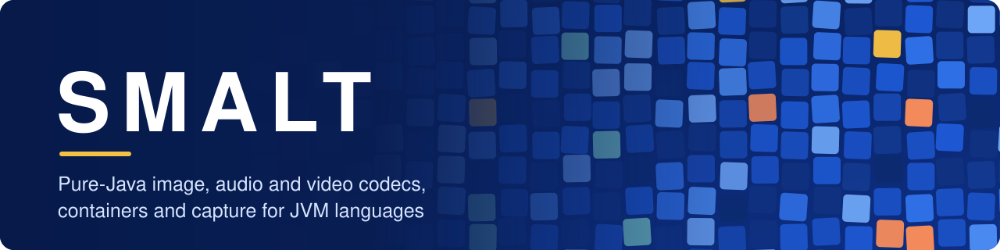
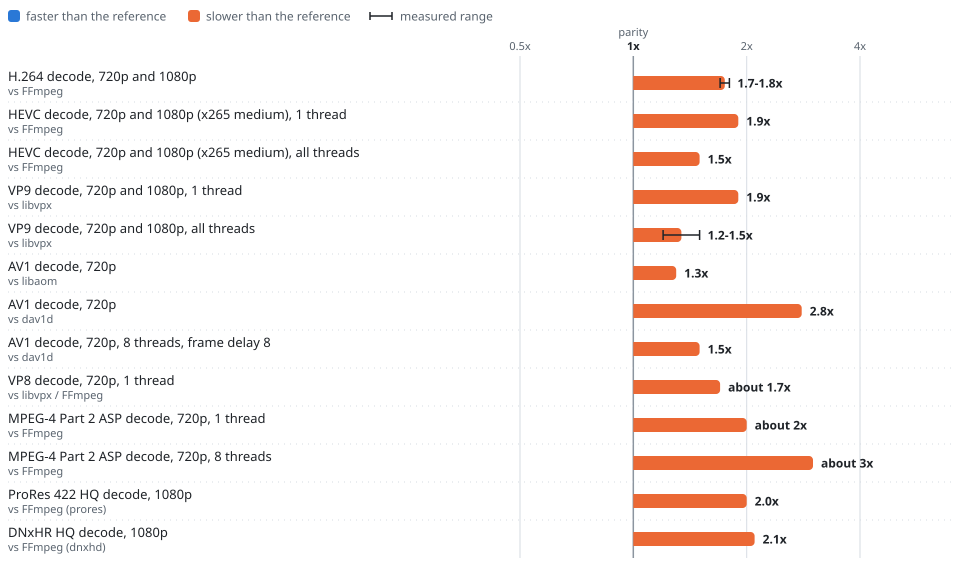
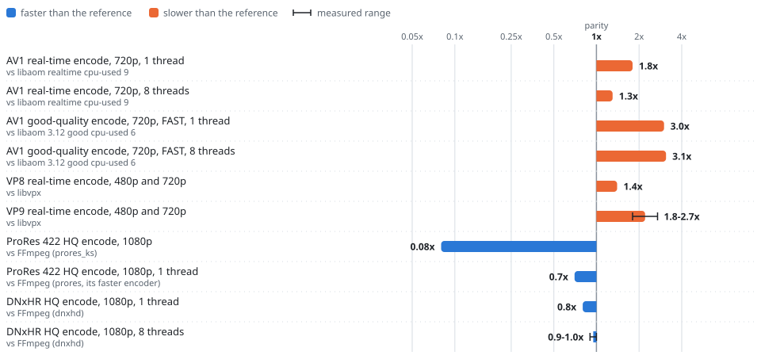
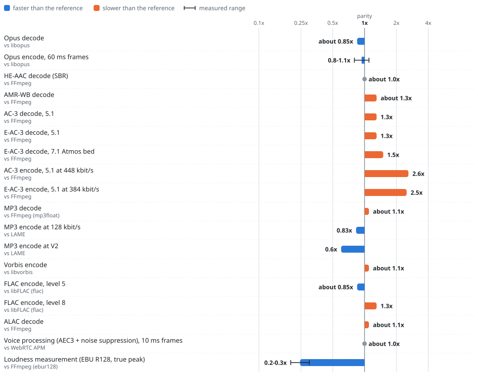
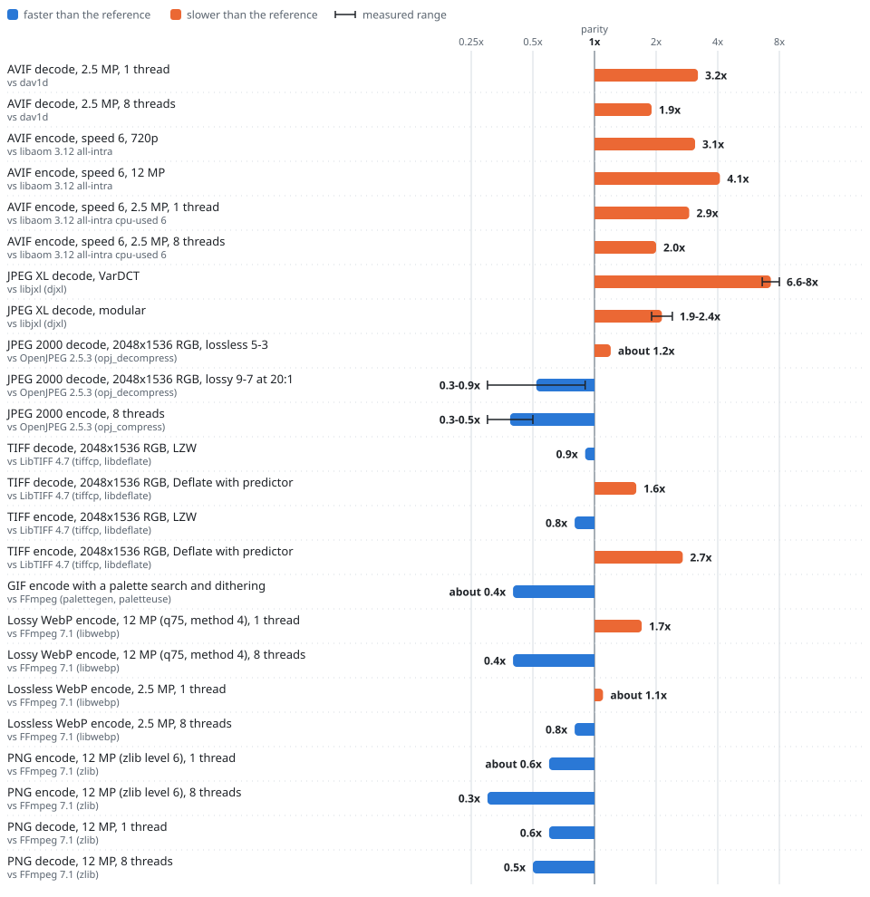
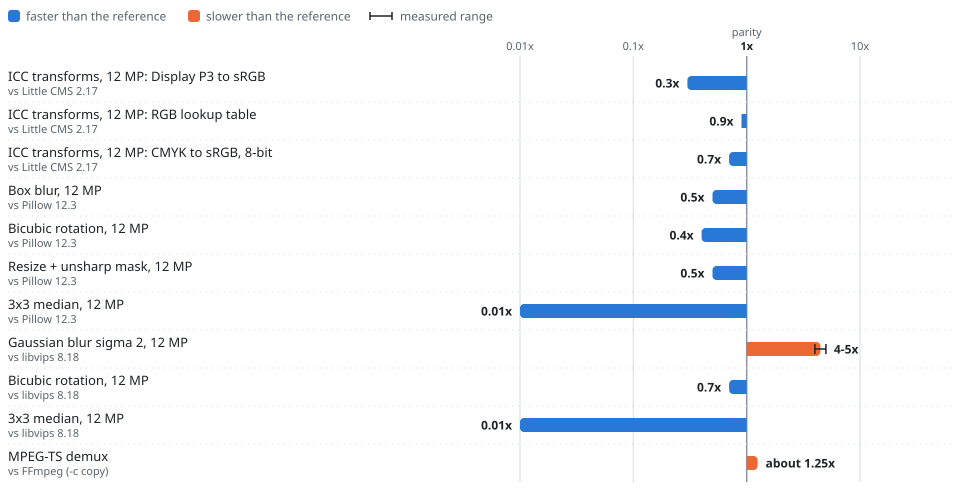

<div align="center">



<br/>

[](https://openjdk.org/projects/jdk/26/)
[](LICENSE)
[](#why-smalt)
[](#documentation)

</div>

# Smalt

Smalt decodes and encodes images, audio and video, reads and writes containers (MP4, MKV, ...) and processes
media in plain Java. It also captures cameras, screens, windows and microphones, and plays to speakers. There is
no FFmpeg, no JNI and no binary to ship: the same jars run on every platform with a JDK 26.

Jump to [Quick start](#quick-start) for code.

## Why Smalt

- **No native code to ship.** Every codec is Java. Only `smalt-capture` calls the OS, through Java's Foreign Function & Memory (FFM) API.
- **No third-party dependencies.** Each artifact needs only the JDK and other Smalt artifacts.
- **Reference output.** The H.264, HEVC, VVC, VP8, VP9 and AV1 decoders match the reference decoders frame for frame on the official conformance suites.
- **Opus matches libopus 1.5.2** bit for bit, in both the encoder and the decoder.
- **Safe on hostile files.** Bad input raises `MediaException`, never a hang or an unbounded allocation past the size caps you set in `MediaLimits`.
- **Take only what you need.** Codecs are split by artifact; the patent-licensed ones live apart in `smalt-mpeg`.

> [!IMPORTANT]
> Smalt is pre-`1.0`: expect breaking changes between releases until the API is frozen.

**Contents:** [Install](#install) · [Modules](#modules) · [JVM flags](#jvm-flags) · [Quick start](#quick-start) ·
[What it handles](#what-it-handles) · [Performance](#performance) · [Documentation](#documentation) ·
[Contributing](#contributing) · [Acknowledgments](#acknowledgments) · [Donations](#donations) · [License](#license)

## Install

Smalt needs **Java 26**. Import the [BOM](bom/README.md) (it pins every Smalt artifact to one version), then add
the artifacts you need without a version.

> [!NOTE]
> Smalt is not on Maven Central yet. Run `mvn install -DskipTests` at the repository root (JDK 26) to put
> `0.1.0-SNAPSHOT` in your local Maven repository.

```xml
<dependencyManagement>
    <dependencies>
        <dependency>
            <groupId>com.github.auties00</groupId>
            <artifactId>smalt-bom</artifactId>
            <version>0.1.0-SNAPSHOT</version>
            <type>pom</type>
            <scope>import</scope>
        </dependency>
    </dependencies>
</dependencyManagement>

<dependencies>
    <dependency>
        <groupId>com.github.auties00</groupId>
        <artifactId>smalt-image</artifactId>
    </dependency>
</dependencies>
```

<details>
<summary><b>Gradle (Kotlin and Groovy)</b></summary>

Kotlin DSL:

```kotlin
repositories { mavenLocal() } // needed only for the local snapshot

dependencies {
    implementation(platform("com.github.auties00:smalt-bom:0.1.0-SNAPSHOT"))
    implementation("com.github.auties00:smalt-image")
}
```

Groovy DSL:

```groovy
repositories { mavenLocal() } // needed only for the local snapshot

dependencies {
    implementation platform('com.github.auties00:smalt-bom:0.1.0-SNAPSHOT')
    implementation 'com.github.auties00:smalt-image'
}
```

</details>

On the module path, add `requires com.github.auties00.smalt.<name>;` for each artifact (`smalt-image` is
`com.github.auties00.smalt.image`). `smalt-core` is `com.github.auties00.smalt`, with no `.core`.

## Modules

Add the artifacts for what you want to do. Each one brings `smalt-core` with it, and the BOM sets every version.

### Probe, remux, edit tags or convert subtitles

`smalt-core` reads and writes every container, edits tags and converts text subtitles (SubRip, WebVTT, ASS,
TTML and more). On its own it encodes only PCM audio and raw video. → [core](core/README.md)

```xml
<dependency>
    <groupId>com.github.auties00</groupId>
    <artifactId>smalt-core</artifactId>
</dependency>
```

### Convert photos

`smalt-image` decodes and encodes JPEG, PNG, WebP, GIF, TIFF, JPEG 2000, JPEG XL and other still image formats,
and edits their metadata. → [image](image/README.md)

```xml
<dependency>
    <groupId>com.github.auties00</groupId>
    <artifactId>smalt-image</artifactId>
</dependency>
```

### Decode a phone video

Phones record MP4 with H.264 or HEVC video and AAC audio. All three codecs are in `smalt-mpeg`, which also has
HEIC photos. → [mpeg](mpeg/README.md)

```xml
<dependency>
    <groupId>com.github.auties00</groupId>
    <artifactId>smalt-mpeg</artifactId>
</dependency>
```

### Write WebM

WebM usually means VP9 video and Opus audio: VP9 is in `smalt-video`, Opus in `smalt-audio`.
→ [video](video/README.md), [audio](audio/README.md)

```xml
<dependency>
    <groupId>com.github.auties00</groupId>
    <artifactId>smalt-video</artifactId>
</dependency>
<dependency>
    <groupId>com.github.auties00</groupId>
    <artifactId>smalt-audio</artifactId>
</dependency>
```

### Develop camera raw files

`smalt-raw` reads DNG and the raw files of Canon, Nikon, Sony, Fujifilm and other cameras, and develops them
into pictures. It brings `smalt-image` too. → [raw](raw/README.md)

```xml
<dependency>
    <groupId>com.github.auties00</groupId>
    <artifactId>smalt-raw</artifactId>
</dependency>
```

### Use cameras, screens, microphones or speakers

`smalt-capture` records cameras, screens, windows and microphones, and plays to speakers, on Windows, macOS
and Linux. See [JVM flags](#jvm-flags) for its native-access flag. → [capture](capture/README.md)

```xml
<dependency>
    <groupId>com.github.auties00</groupId>
    <artifactId>smalt-capture</artifactId>
</dependency>
```

### Use ImageIO or Java Sound

`smalt-desktop` adds no codec of its own: it serves, through `javax.imageio` and `javax.sound.sampled`, the
formats of the codec artifacts next to it. Add it together with those, here `smalt-image`.
→ [desktop](desktop/README.md)

```xml
<dependency>
    <groupId>com.github.auties00</groupId>
    <artifactId>smalt-desktop</artifactId>
</dependency>
<dependency>
    <groupId>com.github.auties00</groupId>
    <artifactId>smalt-image</artifactId>
</dependency>
```

> [!WARNING]
> Read [Licensing](video/README.md#licensing) before you ship ProRes or DNxHD, and [Patents](mpeg/README.md#patents)
> before you ship `smalt-mpeg`.

[`smalt-aot`](aot/README.md) trains a JDK ahead-of-time cache for a faster start, and [`smalt-bom`](bom/README.md)
keeps every artifact on one version.

## JVM flags

No flag is required. These change speed, threads and start-up:

| Flag | When | Effect |
|---|---|---|
| `--add-modules jdk.incubator.vector` | Speed matters | Turns on vectorized (SIMD) code; output is identical without it |
| `-Dsmalt.simd=true` or `false` | You override the default | `true`: SIMD on Windows too; `false`: no SIMD on any OS |
| `-Dsmalt.threads=N` | You want to cap CPU use | Threads for shared parallel work, caller included; default: every processor |
| `--enable-native-access=com.github.auties00.smalt.capture` | You use `smalt-capture` | Silences the native access warning |
| `-XX:AOTCache=app.aot` | Start-up time matters | Starts from a cache trained with [`smalt-aot`](aot/README.md#start-fast-with-an-aot-cache) |

- On the class path, use `--enable-native-access=ALL-UNNAMED`.
- With `jdk.incubator.vector` on a stock JDK 26, an AOT cache speeds up class loading only; see [smalt-aot](aot/README.md#known-limits).
- `MediaRuntime.isVectorized()`, `vectorBits()` and `parallelism()` report what you got. They never change after start-up.

<details>
<summary><b>SIMD requirements and Windows</b></summary>

- SIMD also needs vectors of at least 128 bits, and AVX2 on x86. Otherwise kernels run scalar.
- Kernels written for 256-bit vectors, most video kernels among them, run scalar on 128-bit hardware (ARM NEON, x86 without AVX2).

On affected Windows hosts (seen on Windows Server 2025), compiled code can lose vector state across a hardware
trap, such as a loop's safepoint poll ([JDK-8365196](https://bugs.openjdk.org/browse/JDK-8365196)). The JVM then crashes or a vector kernel
returns a wrong result. This is why SIMD is an opt-in on Windows.

| Setting on an affected host | Result |
|---|---|
| `-XX:UseAVX=0` | Fully safe; also turns off FMA, so `Math.fma` runs in software; Smalt runs scalar |
| `-XX:UseAVX=2 -XX:MaxVectorSize=16` | A mitigation, not proven safe for the JDK's own intrinsics; kernels run at 128 bits |

Smalt reads the x86 AVX level through `jdk.management`. The class path resolves it by default; on the module path
add `--add-modules jdk.management`. Without it, SIMD on x86 needs 256-bit vectors, so the 128-bit mitigation above
runs scalar.

</details>

## Quick start

**Convert a photo to WebP** (`smalt-image`):

```java
var image = Images.decode(Path.of("photo.jpg"));
var options = ImageEncoderOptions.builder().quality(80).metadataOf(image).build();
Files.write(Path.of("photo.webp"), Images.encode(image.picture(), ImageFormat.WEBP, options));
```

**Probe a file** (`smalt-core` alone):

```java
var info = Media.probe(Path.of("talk.mp4"));
System.out.println(info.containerName().orElse("?"));
info.video().ifPresent(video -> System.out.println(
        video.codec() + " " + video.displayWidth() + "x" + video.displayHeight()));
```

**Trim a clip and re-encode it to WebM** (`smalt-mpeg` decodes H.264 and AAC, `smalt-video` and `smalt-audio`
encode VP9 and Opus):

```java
var options = TranscodeOptions.of(OutputContainer.WEBM).toBuilder()
        .range(10_000_000, 40_000_000) // microseconds
        .video(VideoTranscodeOptions.builder().maxSize(0, 480).build()) // 0 = any width
        .build();
Transcoder.transcode(Path.of("talk.mp4"), Path.of("talk.webm"), options);
```

**Read video frames** (`smalt-mpeg` for H.264; each picture is valid until the next `read()`):

```java
try (var source = MediaSource.of(Path.of("talk.mp4"));
     var reader = VideoReader.open(source)) {
    for (var frame = reader.read(); frame != null; frame = reader.read()) {
        System.out.println(frame.picture().width() + "x" + frame.picture().height());
    }
}
```

Every module README has more examples: start from [Modules](#modules).

## What it handles

Highlights per media kind; each artifact's README lists every profile and limit.

### Images

| Format | Decode | Encode | Artifact |
|---|:-:|:-:|---|
| JPEG, JPEG-LS, JPEG 2000, JPEG XL | ✅ | ✅ | [image](image/README.md#formats) |
| PNG and APNG, GIF, WebP, BMP, TIFF and BigTIFF | ✅ | ✅ | [image](image/README.md#formats) |
| ICO and CUR, ANI, ICNS, Netpbm, TGA, QOI, Radiance HDR | ✅ | ✅ | [image](image/README.md#formats) |
| Hierarchical JPEG, PSD and PSB, OpenEXR, DDS, JPEG XR | ✅ | ❌ | [image](image/README.md#formats) |
| AVIF | ✅ | ✅ | [video](video/README.md#formats) |
| HEIC and HEIF, JPEG XS | ✅ | ✅ | [mpeg](mpeg/README.md#formats) |
| DNG | ✅ | ✅ | [raw](raw/README.md#formats) |
| Camera raw: CR3, CR2, NEF, ARW, RAF, ORF, RW2, PEF, X3F and more | ✅ | ❌ | [raw](raw/README.md#formats) |

✅ supported · ❌ not supported

### Audio

| Format | Decode | Encode | Artifact |
|---|:-:|:-:|---|
| Opus, Vorbis, FLAC, ALAC, MP3, MP2 and MP1 | ✅ | ✅ | [audio](audio/README.md#formats) |
| IMA and Microsoft ADPCM, G.722, G.726, GSM 06.10 | ✅ | ✅ | [audio](audio/README.md#formats) |
| Speex, Musepack, ATRAC9, MACE, WavPack, Monkey's Audio, DST | ✅ | ❌ | [audio](audio/README.md#formats) |
| AAC-LC, HE-AAC v1 and v2, AAC-LD and AAC-ELD | ✅ | ✅ | [mpeg](mpeg/README.md#formats) |
| AMR-NB and AMR-WB, AC-3, E-AC-3 | ✅ | ✅ | [mpeg](mpeg/README.md#formats) |
| USAC, other AAC profiles, MPEG Surround, DTS and DTS-HD | ✅ | ❌ | [mpeg](mpeg/README.md#formats) |
| MPEG-4 CELP, TwinVQ and HVXC | ✅ | ❌ | [mpeg](mpeg/README.md#formats) |
| PCM (integer and float), G.711 A-law and mu-law | ✅ | ✅ | [core](core/README.md#formats) |
| DSD, DSD over PCM | ✅ | ❌ | [core](core/README.md#formats) |

### Video

| Format | Decode | Encode | Artifact |
|---|:-:|:-:|---|
| H.264, HEVC, MPEG-4 Part 2, H.263, JPEG XS | ✅ | ✅ | [mpeg](mpeg/README.md#formats) |
| VVC, MPEG-1 and MPEG-2, VC-1, Sorenson Spark | ✅ | ❌ | [mpeg](mpeg/README.md#formats) |
| VP9, AV1 | ✅ | ✅ | [video](video/README.md#formats) |
| ProRes, DNxHD and DNxHR, DV, FFV1, Theora, QuickTime Animation | ✅ | ✅ | [video](video/README.md#formats) |
| GoPro CineForm | ✅ | ❌ | [video](video/README.md#formats) |
| VP8, Motion-JPEG, Motion JPEG 2000, PNG and TIFF video, HAP | ✅ | ✅ | [image](image/README.md#formats) |
| GIF video | ✅ | ❌ | [image](image/README.md#formats) |
| Raw video, raw video in MP4 (`uncv`) | ✅ | ✅ | [core](core/README.md#formats) |

### Containers

Every container lives in core, so remuxing, probing and tag editing need no codec artifact.

| Format | Demux | Mux | Artifact |
|---|:-:|:-:|---|
| MP4, MOV, M4A, 3GP, MJ2, fragmented MP4 and CMAF | ✅ | ✅ | [core](core/README.md#formats) |
| Matroska, WebM, Ogg | ✅ | ✅ | [core](core/README.md#formats) |
| MPEG-TS and M2TS, MPEG-PS and VOB, MXF | ✅ | ✅ | [core](core/README.md#formats) |
| AVI, FLV, DV, IVF, Y4M | ✅ | ✅ | [core](core/README.md#formats) |
| Elementary streams: H.264, HEVC, VVC, AV1, MPEG-4 Part 2, H.263 | ✅ | ✅ | [core](core/README.md#formats) |
| WAV and RF64 (also IEC 61937 bursts), Wave64, AIFF, CAF, AU | ✅ | ✅ | [core](core/README.md#formats) |
| MP3, FLAC, ADTS, LOAS/LATM, ADIF, AMR, AC-3 and E-AC-3, WavPack, raw PCM | ✅ | ✅ | [core](core/README.md#formats) |
| ASF (WMV; WMA audio is not decoded), BW64, RIFX | ✅ | ❌ | [core](core/README.md#formats) |
| DTS, Monkey's Audio, Musepack, DSF, DSDIFF | ✅ | ❌ | [core](core/README.md#formats) |

### Subtitles and streaming

| Format | Read | Write | Artifact |
|---|:-:|:-:|---|
| SubRip, WebVTT, SSA and ASS, TTML and IMSC, SAMI, LRC, MicroDVD, 3GPP timed text | ✅ | ✅ | [core](core/README.md#formats) |
| PGS (`.sup`), VobSub | ✅ | ❌ | [core](core/README.md#formats) |
| DVB subtitles, DVB teletext, CEA-608 and CEA-708 | ✅ | ❌ | [core](core/README.md#formats) |
| HLS (MPEG-TS or CMAF segments), DASH (CMAF segments) | ✅ | ✅ | [core](core/README.md#formats) |
| AES-128, SAMPLE-AES, CENC encryption (clear keys) | ✅ | ✅ | [core](core/README.md#formats) |
| RTP payloads: H.264, VP8, VP9, AV1, Opus, AMR, AAC | ✅ | ✅ | [core](core/README.md#formats) |

Smalt does not draw text into PGS or VobSub bitmaps; `SupMuxer` and `VobSubMuxer` only copy existing packets.

## Performance

Each bar is Smalt's time divided by the native library's time: 2.0x means Smalt takes twice as long, 0.5x half
as long. Rows use one thread with SIMD on unless they say otherwise (i7-9700K, AVX2). BD-rate is the size
difference at equal quality.

<!-- perf:begin -->
<!-- Generated by tools/readme/charts.py from tools/readme/performance.tsv; do not edit by hand. -->

### Video decoding

One thread unless the row says otherwise.

<picture>
  <source media="(prefers-color-scheme: dark)" srcset=".github/assets/perf-video-decode-dark.svg">
  
</picture>

<details>
<summary>Video decoding: the numbers as text</summary>

- H.264 decode, 720p and 1080p, against FFmpeg: **1.7-1.8x**
- HEVC decode, 720p and 1080p (x265 medium), 1 thread, against FFmpeg: **1.9x**
- HEVC decode, 720p and 1080p (x265 medium), all threads, against FFmpeg: **1.5x**
- VP9 decode, 720p and 1080p, 1 thread, against libvpx: **1.9x**
- VP9 decode, 720p and 1080p, all threads, against libvpx: **1.2-1.5x**
- AV1 decode, 720p, against libaom: **1.3x**
- AV1 decode, 720p, against dav1d: **2.8x**
- AV1 decode, 720p, 8 threads, frame delay 8, against dav1d: **1.5x**
- VP8 decode, 720p, 1 thread, against libvpx / FFmpeg: **about 1.7x**
- MPEG-4 Part 2 ASP decode, 720p, 1 thread, against FFmpeg: **about 2x**
- MPEG-4 Part 2 ASP decode, 720p, 8 threads, against FFmpeg: **about 3x**
- ProRes 422 HQ decode, 1080p, against FFmpeg (prores): **2.0x**
- DNxHR HQ decode, 1080p, against FFmpeg (dnxhd): **2.1x**

</details>

### Video encoding

BD-rate against the reference encoder is in the text list.

<picture>
  <source media="(prefers-color-scheme: dark)" srcset=".github/assets/perf-video-encode-dark.svg">
  
</picture>

<details>
<summary>Video encoding: the numbers as text</summary>

- AV1 real-time encode, 720p, 1 thread, against libaom realtime cpu-used 9: **1.8x** (BD-rate 3.7% PSNR-Y higher)
- AV1 real-time encode, 720p, 8 threads, against libaom realtime cpu-used 9: **1.3x** (BD-rate 3.7% PSNR-Y higher)
- AV1 good-quality encode, 720p, FAST, 1 thread, against libaom 3.12 good cpu-used 6: **3.0x** (BD-rate 15% PSNR-Y, 19% SSIM-Y higher)
- AV1 good-quality encode, 720p, FAST, 8 threads, against libaom 3.12 good cpu-used 6: **3.1x** (BD-rate 15% PSNR-Y, 19% SSIM-Y higher)
- VP8 real-time encode, 480p and 720p, against libvpx: **1.4x** (BD-rate 2.6% PSNR-Y, 2.9% SSIM-Y lower)
- VP9 real-time encode, 480p and 720p, against libvpx: **1.8-2.7x** (BD-rate 14% PSNR-Y, 16.5% SSIM-Y lower)
- ProRes 422 HQ encode, 1080p, against FFmpeg (prores_ks): **0.08x**
- ProRes 422 HQ encode, 1080p, 1 thread, against FFmpeg (prores, its faster encoder): **0.7x**
- DNxHR HQ encode, 1080p, 1 thread, against FFmpeg (dnxhd): **0.8x**
- DNxHR HQ encode, 1080p, 8 threads, against FFmpeg (dnxhd): **0.9-1.0x**

</details>

### Audio

Codecs, voice processing and loudness measurement.

<picture>
  <source media="(prefers-color-scheme: dark)" srcset=".github/assets/perf-audio-dark.svg">
  
</picture>

<details>
<summary>Audio: the numbers as text</summary>

- Opus decode, against libopus: **about 0.85x**
- Opus encode, 60 ms frames, against libopus: **0.8-1.1x**
- HE-AAC decode (SBR), against FFmpeg: **about 1.0x**
- AMR-WB decode, against FFmpeg: **about 1.3x**
- AC-3 decode, 5.1, against FFmpeg: **1.3x**
- E-AC-3 decode, 5.1, against FFmpeg: **1.3x**
- E-AC-3 decode, 7.1 Atmos bed, against FFmpeg: **1.5x**
- AC-3 encode, 5.1 at 448 kbit/s, against FFmpeg: **2.6x** (with channel coupling)
- E-AC-3 encode, 5.1 at 384 kbit/s, against FFmpeg: **2.5x** (with channel coupling)
- MP3 decode, against FFmpeg (mp3float): **about 1.1x**
- MP3 encode at 128 kbit/s, against LAME: **0.83x**
- MP3 encode at V2, against LAME: **0.6x**
- Vorbis encode, against libvorbis: **about 1.1x**
- FLAC encode, level 5, against libFLAC (flac): **about 0.85x**
- FLAC encode, level 8, against libFLAC (flac): **1.3x**
- ALAC decode, against FFmpeg: **about 1.1x**
- Voice processing (AEC3 + noise suppression), 10 ms frames, against WebRTC APM: **about 1.0x**
- Loudness measurement (EBU R128, true peak), against FFmpeg (ebur128): **0.2-0.3x**

</details>

### Still images

Decoding and encoding of whole images.

<picture>
  <source media="(prefers-color-scheme: dark)" srcset=".github/assets/perf-images-dark.svg">
  
</picture>

<details>
<summary>Still images: the numbers as text</summary>

- AVIF decode, 2.5 MP, 1 thread, against dav1d: **3.2x**
- AVIF decode, 2.5 MP, 8 threads, against dav1d: **1.9x**
- AVIF encode, speed 6, 720p, against libaom 3.12 all-intra: **3.1x** (BD-rate 0-7% lower)
- AVIF encode, speed 6, 12 MP, against libaom 3.12 all-intra: **4.1x** (BD-rate 0-7% lower)
- AVIF encode, speed 6, 2.5 MP, 1 thread, against libaom 3.12 all-intra cpu-used 6: **2.9x** (BD-rate 2% PSNR-Y, 5% SSIM-Y lower)
- AVIF encode, speed 6, 2.5 MP, 8 threads, against libaom 3.12 all-intra cpu-used 6: **2.0x** (BD-rate 2% PSNR-Y, 5% SSIM-Y lower)
- JPEG XL decode, VarDCT, against libjxl (djxl): **6.6-8x**
- JPEG XL decode, modular, against libjxl (djxl): **1.9-2.4x**
- JPEG 2000 decode, 2048x1536 RGB, lossless 5-3, against OpenJPEG 2.5.3 (opj_decompress): **about 1.2x** (loaded machine, wide error bars)
- JPEG 2000 decode, 2048x1536 RGB, lossy 9-7 at 20:1, against OpenJPEG 2.5.3 (opj_decompress): **0.3-0.9x** (loaded machine, wide error bars)
- JPEG 2000 encode, 8 threads, against OpenJPEG 2.5.3 (opj_compress): **0.3-0.5x**
- TIFF decode, 2048x1536 RGB, LZW, against LibTIFF 4.7 (tiffcp, libdeflate): **0.9x**
- TIFF decode, 2048x1536 RGB, Deflate with predictor, against LibTIFF 4.7 (tiffcp, libdeflate): **1.6x**
- TIFF encode, 2048x1536 RGB, LZW, against LibTIFF 4.7 (tiffcp, libdeflate): **0.8x**
- TIFF encode, 2048x1536 RGB, Deflate with predictor, against LibTIFF 4.7 (tiffcp, libdeflate): **2.7x**
- GIF encode with a palette search and dithering, against FFmpeg (palettegen, paletteuse): **about 0.4x** (8% smaller, 1.6 dB better)
- Lossy WebP encode, 12 MP (q75, method 4), 1 thread, against FFmpeg 7.1 (libwebp): **1.7x** (byte-identical to libwebp)
- Lossy WebP encode, 12 MP (q75, method 4), 8 threads, against FFmpeg 7.1 (libwebp): **0.4x** (byte-identical to libwebp; see the eight-thread caveat)
- Lossless WebP encode, 2.5 MP, 1 thread, against FFmpeg 7.1 (libwebp): **about 1.1x**
- Lossless WebP encode, 2.5 MP, 8 threads, against FFmpeg 7.1 (libwebp): **0.8x** (see the eight-thread caveat)
- PNG encode, 12 MP (zlib level 6), 1 thread, against FFmpeg 7.1 (zlib): **about 0.6x** (Smalt's own deflate compressor, 0.4x of the JDK zlib's time at level 6)
- PNG encode, 12 MP (zlib level 6), 8 threads, against FFmpeg 7.1 (zlib): **0.3x** (the PNG split into independently deflated bands of about 1 MiB; see the eight-thread caveat)
- PNG decode, 12 MP, 1 thread, against FFmpeg 7.1 (zlib): **0.6x**
- PNG decode, 12 MP, 8 threads, against FFmpeg 7.1 (zlib): **0.5x** (see the eight-thread caveat)

</details>

### Processing and demuxing

Color transforms, picture operations and container reading.

<picture>
  <source media="(prefers-color-scheme: dark)" srcset=".github/assets/perf-processing-dark.svg">
  
</picture>

<details>
<summary>Processing and demuxing: the numbers as text</summary>

- ICC transforms, 12 MP: Display P3 to sRGB, against Little CMS 2.17: **0.3x**
- ICC transforms, 12 MP: RGB lookup table, against Little CMS 2.17: **0.9x**
- ICC transforms, 12 MP: CMYK to sRGB, 8-bit, against Little CMS 2.17: **0.7x**
- Box blur, 12 MP, against Pillow 12.3: **0.5x**
- Bicubic rotation, 12 MP, against Pillow 12.3: **0.4x**
- Resize + unsharp mask, 12 MP, against Pillow 12.3: **0.5x**
- 3x3 median, 12 MP, against Pillow 12.3: **0.01x**
- Gaussian blur sigma 2, 12 MP, against libvips 8.18: **4-5x**
- Bicubic rotation, 12 MP, against libvips 8.18: **0.7x**
- 3x3 median, 12 MP, against libvips 8.18: **0.01x**
- MPEG-TS demux, against FFmpeg (-c copy): **about 1.25x**

</details>

<!-- perf:end -->

<details>
<summary><b>The eight-thread caveat</b></summary>

The eight-thread still image rows come from same-JVM interleaved comparisons, combined with the FFmpeg times
of the quiet machine. They carry the noise of a shared machine.

</details>

<details>
<summary><b>What CI measures</b></summary>

CI runners are shared virtual machines whose speed drifts between runs, so CI compares only within one job
([tools/bench](tools/bench/README.md)):

| When | What | Fails when |
|---|---|---|
| Every pull request | Bytes allocated per operation, base against head | The head allocates over 1% + 256 B more, unless labeled `allocation-accepted` |
| Weekly and on demand | Time of the hot paths, base and head forks interleaved | A case is 20% or more slower |

The figures above come from the desktop, not from CI. The numbers live in
[tools/readme/performance.tsv](tools/readme/performance.tsv), and `python tools/readme/charts.py` redraws the charts.

</details>

## Documentation

- Each module README covers its formats, examples and known limits: start from [Modules](#modules).
- The Javadoc states the contract of the exported API. It goes live on [javadoc.io](https://javadoc.io/doc/com.github.auties00/smalt-core) with the first release.
- Until then, after `mvn install -DskipTests`, run `mvn javadoc:javadoc -pl core` (or any module) and open `core/target/reports/apidocs/index.html`.
- Missing a format or feature? Open an [issue](https://github.com/Auties00/Smalt/issues).

## Contributing

Contributions are welcome: new formats, faster kernels, bug reports with sample files, measurements on hardware
the maintainer does not have. Read [CONTRIBUTING.md](CONTRIBUTING.md) first: it covers the build, the tests and the rules for
ported code.

## Acknowledgments

Thank you to every author and maintainer below for sharing your work; any mistake in Smalt's reading of it is
Smalt's own.

<details>
<summary><b>Ported or derived code: video</b></summary>

| Project | What Smalt uses it for |
|---|---|
| [libvpx](https://chromium.googlesource.com/webm/libvpx) | VP8 and VP9 codecs |
| [libaom](https://aomedia.googlesource.com/aom) | AV1 codec |
| [dav1d](https://code.videolan.org/videolan/dav1d) | AV1 decoder |
| [libavif](https://github.com/AOMediaCodec/libavif) | AVIF, gain maps, HEIF canvas |
| [libtheora](https://www.theora.org/) | Theora codec |
| [cineform-sdk](https://github.com/gopro/cineform-sdk) (GoPro) | CineForm decoder |
| [JM](https://vcgit.hhi.fraunhofer.de/jvet/JM) reference software | H.264 |
| [OpenH264](https://github.com/cisco/openh264) | H.264 tables and motion search |
| 3DV-ATM 14.0 reference software (ITU-T H.264.2) | 3D-AVC decoding |
| [HM](https://vcgit.hhi.fraunhofer.de/jvet/HM) reference software, with SCM | HEVC, screen content coding |
| [HTM](https://vcgit.hhi.fraunhofer.de/jvet/HTM) 16.3 reference software | 3D-HEVC decoding |
| [VVdeC](https://github.com/fraunhoferhhi/vvdec) 3.3.0 (Fraunhofer HHI) | VVC decoder |
| Microsoft MPEG-4 Visual reference software (ISO/IEC 14496-5) | MPEG-4 shape, sprite, N-bit and scalability tools |
| MoMuSys Studio Profile reference software (Sony) | MPEG-4 Studio decoder |
| MPEG Software Simulation Group mpeg2decode (ISO/IEC 13818-5) | MPEG-2 variable length code tables |
| [SVT-JPEG-XS](https://github.com/OpenVisualCloud/SVT-JPEG-XS) (Intel) | JPEG XS codec, Nikon HE raw |
| [dovi_tool](https://github.com/quietvoid/dovi_tool) (quietvoid) | Dolby Vision RPU parser |

</details>

<details>
<summary><b>Ported or derived code: audio</b></summary>

| Project | What Smalt uses it for |
|---|---|
| [libopus](https://opus-codec.org/) 1.5.2 | Opus, with the LPCNet, FARGAN, DRED, LACE and NoLACE networks |
| [KISS FFT](https://github.com/mborgerding/kissfft), as modified in libopus | Opus transforms |
| [opusfile](https://opus-codec.org/) | Opus stereo downmix |
| [WebRTC](https://webrtc.googlesource.com/src) audio processing ([webrtc-audio-processing](https://gitlab.freedesktop.org/pulseaudio/webrtc-audio-processing)) | Voice processing |
| [RNNoise](https://gitlab.xiph.org/xiph/rnnoise) | Noise suppression |
| [PFFFT](https://bitbucket.org/jpommier/pffft) (Julien Pommier) | Voice processing FFT |
| [Ooura FFT](http://www.kurims.kyoto-u.ac.jp/~ooura/fft.html) (Takuya Ooura) | FFTs, via WebRTC |
| Wilco Dijkstra's integer square root, via WebRTC | Voice processing |
| [libvorbis](https://xiph.org/vorbis/), with aoTuV | Vorbis codec |
| [libogg](https://xiph.org/ogg/) | Ogg page reading |
| [libFLAC](https://xiph.org/flac/) | FLAC codec |
| [libspeex](https://www.speex.org/) | Speex decoder |
| [WavPack](https://www.wavpack.com/) (David Bryant) | WavPack decoder |
| [Monkey's Audio](https://www.monkeysaudio.com/) SDK (Matthew T. Ashland) | Monkey's Audio decoder |
| libmpcdec ([Musepack](https://www.musepack.net/) Development Team) | Musepack decoder |
| [LibAtrac9](https://github.com/Thealexbarney/LibAtrac9) (Alex Barney) | ATRAC9 decoder |
| Apple [ALAC](https://github.com/macosforge/alac) | ALAC codec |
| [minimp3](https://github.com/lieff/minimp3) | MP3 decoder |
| ISO/IEC 13818-5 dist10 MPEG audio software | MP2 encoder, psychoacoustic model, multichannel |
| [libgsm](https://www.quut.com/gsm/) (Jutta Degener, Carsten Bormann) | GSM 06.10 |
| [fdlibm](https://www.netlib.org/fdlibm/), [musl](https://musl.libc.org/) | Portable math functions |
| [opencore-amr and vo-amrwbenc](https://sourceforge.net/projects/opencore-amr/) | AMR-NB and AMR-WB |
| PacketVideo AAC decoder, VisualOn AAC encoder ([AOSP](https://source.android.com/)) | AAC codec |
| [libxaac](https://github.com/ittiam-systems/libxaac) | AAC-LD, ELD and error resilience tools |
| ISO/IEC 23003-3 USAC reference software | USAC, eSBR, MPEG Surround, BSAC, CELP, scalable AAC |
| ISO/IEC 23003-4 MPEG-D DRC reference software | Dynamic range control |
| ISO/IEC 14496-3 HVXC reference software | HVXC decoder |
| ISO/IEC 14496-3 TwinVQ reference software | TwinVQ decoder |
| NTT DoCoMo error protection tool (ISO/IEC 14496-5) | AAC error protection |
| DST module of the MPEG-4 Audio reference software (Philips) | DST decoder |

</details>

<details>
<summary><b>Ported or derived code: images, processing and raw</b></summary>

| Project | What Smalt uses it for |
|---|---|
| [libjpeg-turbo](https://libjpeg-turbo.org/) and the [Independent JPEG Group](https://ijg.org/) | JPEG codec |
| [libwebp](https://chromium.googlesource.com/webm/libwebp) | WebP codec |
| [libjxl](https://github.com/libjxl/libjxl), [jxl-oxide](https://github.com/tirr-c/jxl-oxide) | JPEG XL codec |
| [OpenJPEG](https://www.openjpeg.org/), [OpenJPH](https://github.com/aous72/OpenJPH), [OpenHTJ2K](https://github.com/osamu620/OpenHTJ2K) | JPEG 2000 and HTJ2K |
| [CharLS](https://github.com/team-charls/charls) | JPEG-LS |
| [LibTIFF](https://libtiff.gitlab.io/libtiff/), Esri [LERC](https://github.com/Esri/lerc) | TIFF and its compressions |
| [giflib](https://sourceforge.net/projects/giflib/) | GIF |
| [OpenEXR](https://openexr.com/) | OpenEXR decoder |
| [jxrlib](https://github.com/4creators/jxrlib) (Microsoft) | JPEG XR decoder |
| [DirectXTex](https://github.com/microsoft/DirectXTex) (Microsoft), [bcdec](https://github.com/iOrange/bcdec) | DDS textures |
| [psd-tools](https://github.com/psd-tools/psd-tools) (Kota Yamaguchi) | PSD layer compositing |
| [libultrahdr](https://github.com/google/libultrahdr) | Ultra HDR gain maps |
| [zlib](https://zlib.net), [libdeflate](https://github.com/ebiggers/libdeflate) | Deflate |
| [XZ for Java](https://tukaani.org/xz/java.html) | LZMA and branch filters |
| [Brotli](https://github.com/google/brotli), [bzip2](https://sourceware.org/bzip2/), [lzokay](https://github.com/jackoalan/lzokay) | Decompressors |
| [Little CMS](https://www.littlecms.com/) 2.17 | Color management |
| [Pillow](https://python-pillow.github.io/) | Picture operations |
| Anthony Dekker's NeuQuant | Palette quantization |
| [smartcrop.js](https://github.com/jwagner/smartcrop.js) | Smart crop |
| [libebur128](https://github.com/jiixyj/libebur128) | Loudness and true peak |
| [Shaka Packager](https://github.com/shaka-project/shaka-packager) | Common Encryption |
| Adobe [DNG SDK](https://android.googlesource.com/platform/external/dng_sdk) and DNG specification | DNG reading, opcodes, Hasselblad calibration |
| [X3F tools](https://github.com/Kalpanika/x3f) (Roland and Erik Karlsson) | Sigma X3F |
| [gpr](https://github.com/gopro/gpr) (GoPro) | VC-5 decoder of GPR files |
| [arw](https://github.com/Soreil/arw) (Sjon Kosse) | Sony ARW |
| [colour-demosaicing](https://github.com/colour-science/colour-demosaicing) | Demosaicing |
| [rawtoaces-data](https://github.com/AcademySoftwareFoundation/rawtoaces-data) | Camera spectral data |

Smalt also follows ideas from [stb](https://github.com/nothings/stb), [libpng](http://www.libpng.org/pub/png/libpng.html)
and Nicolas Devillard's median networks.

</details>

<details>
<summary><b>Specifications</b></summary>

Much of Smalt is written from the specifications alone. Thank you to the bodies and authors who publish them:

| Area | Specifications |
|---|---|
| Video (ITU-T, ISO/IEC) | MPEG-1, MPEG-2, MPEG-4 Part 2, H.263, H.264, HEVC |
| Video (open specifications) | AOMedia AV1, VP8 (RFC 6386), VP9 |
| Professional video | SMPTE RDD 36 (ProRes), ST 2019-1 (VC-3), RDD 5 (film grain); Vidvox HAP |
| Images (ISO/IEC) | JPEG, JPEG 2000, JPEG XL, JPEG XS (ISO/IEC 21122) |
| Images (other) | W3C PNG; Adobe TIFF and DNG; EXIF, XMP, IPTC, ICC |
| Audio (MPEG) | MPEG audio and AAC |
| Audio (ATSC, ETSI) | ATSC A/52 and ETSI TS 102 366 (AC-3, E-AC-3) |
| Speech | 3GPP AMR; ITU-T G.722, G.726; ETSI GSM 06.10 |
| Containers (ISO) | ISO base media file format, HEIF, MPEG-TS |
| Containers (other) | Matroska and FFV1 (IETF CELLAR); Ogg; FLV and Enhanced RTMP |
| Streaming | RFC 8216 (HLS), MPEG-DASH with the DASH-IF guidelines; RTP payload RFCs |
| Subtitles | WebVTT, TTML and IMSC, 3GPP TS 26.245, SubStation Alpha |
| Color and loudness | ITU-T H.273, ITU-R BT.2100 and BS.1770, ISO 21496-1 gain maps, EBU R 128, CIECAM97s |
| Camera raw | Canon CIFF, Sigma X3F; [ExifTool](https://exiftool.org/) tag docs |
| Camera raw write-ups | Laurent Clevy, Bill Claff and Henry Dietz |

The [raw.pixls.us](https://raw.pixls.us/) archive of CC0 sample files made the clean-room raw decoders possible.

</details>

<details>
<summary><b>Tools that verify Smalt</b></summary>

| Project | What Smalt uses it for |
|---|---|
| [FFmpeg](https://ffmpeg.org/) 7.1 and ffprobe | Main black-box test oracle |
| Reference tools of libvpx, libaom, dav1d, libwebp, OpenJPEG, OpenJPH, libjxl, libjpeg-turbo, LibTIFF, libFLAC, libopus | Decoders and encoders to compare against |
| HM, JM, JMVC, JSVM, [SHM](https://vcgit.hhi.fraunhofer.de/jvet/SHM), x264, x265, TMN H.263 | Makers and decoders of test streams |
| ISO/IEC 13818-5, 14496-5 and 21122-5 reference software | MPEG-2, MPEG-4 Visual and JPEG XS oracles |
| [libheif](https://github.com/strukturag/libheif), libavif, libultrahdr | HEIF, AVIF and gain map oracles |
| [ExifTool](https://exiftool.org/), Adobe DNG SDK `dng_validate`, Adobe DNG Converter | Metadata and DNG checks |
| [GPAC](https://gpac.io/) MP4Box, [MKVToolNix](https://mkvtoolnix.download/), mkvalidator, [TSDuck](https://tsduck.io/), [bmx](https://github.com/bbc/bmx) | Container checks |
| Little CMS, libpng, giflib, Apple ALAC, LibAtrac9 | Small reference drivers |
| Kakadu | JPEG 2000 test fixtures |
| [tifffile](https://github.com/cgohlke/tifffile), [imagecodecs](https://github.com/cgohlke/imagecodecs), [OpenSlide](https://openslide.org/), [libvips](https://www.libvips.org/), Pillow, JBIG-KIT | Image oracles and benchmarks |
| [zimg](https://github.com/sekrit-twc/zimg), [libplacebo](https://code.videolan.org/videolan/libplacebo) (through FFmpeg) | Color conversion and Dolby Vision references |
| jxrlib's JxrEncApp, Apple sips, QuickTime 7, avconvert | Test files for JPEG XR, ICNS, MACE, HEVC with alpha |
| [FDK AAC](https://github.com/mstorsjo/fdk-aac), Windows Media Foundation | AAC, VC-1 and E-AC-3 references |
| [imscJS](https://github.com/sandflow/imscJS) | IMSC reference |
| [Jazzer](https://github.com/CodeIntelligenceTesting/jazzer), [ClusterFuzzLite](https://google.github.io/clusterfuzzlite/) | Fuzzing |
| [JUnit](https://junit.org/), [JMH](https://github.com/openjdk/jmh), [jcstress](https://github.com/openjdk/jcstress), [JaCoCo](https://www.jacoco.org/) | Tests, benchmarks, concurrency, coverage |
| [forbidden-apis](https://github.com/policeman-tools/forbidden-apis) | Bans of CPU-dependent and unsafe APIs |
| [Chicory](https://github.com/dylibso/chicory) | Runs WebRTC's audio processing as WebAssembly for comparison |

Test vectors come from the ITU-T and ISO conformance suites, the WebM project, AOMedia, the JPEG XL
conformance suite, [Xiph.Org](https://media.xiph.org/) test media, PngSuite, BMP Suite, the FFmpeg FATE suite and
raw.pixls.us, among others.

</details>

## Donations

Smalt is maintained in my free time. If you like it, you can support it through
[GitHub Sponsors](https://github.com/sponsors/Auties00).

## License

Smalt is released under the [MIT License](LICENSE). Each jar lists, in `META-INF/THIRD-PARTY-NOTICES`, the ported
projects whose licenses ask for attribution, with those licenses.

- `smalt-raw` includes DNG technology under license by Adobe.
- H.264, HEVC, VVC, AAC and AMR in `smalt-mpeg` are covered by patents licensed through patent pools.
- E-AC-3 may still be covered by Dolby patents; the AC-3 patents expired in 2017.

The MIT License covers Smalt's code only and grants no patent rights. These notes are orientation, not legal
advice: check whether your use needs a license, and see [Patents](mpeg/README.md#patents).

> [!WARNING]
> ProRes, DNxHD and DNxHR belong to companies that license implementations. Both codecs ship in `smalt-video`:
> read [Licensing](video/README.md#licensing).
